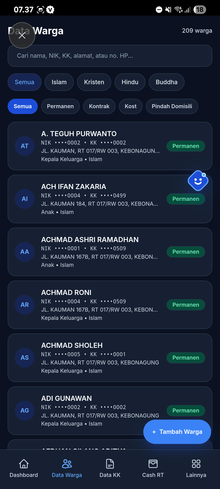
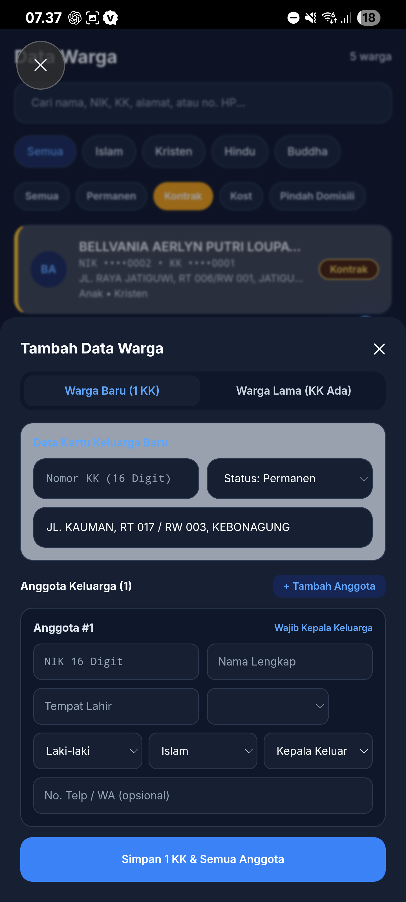
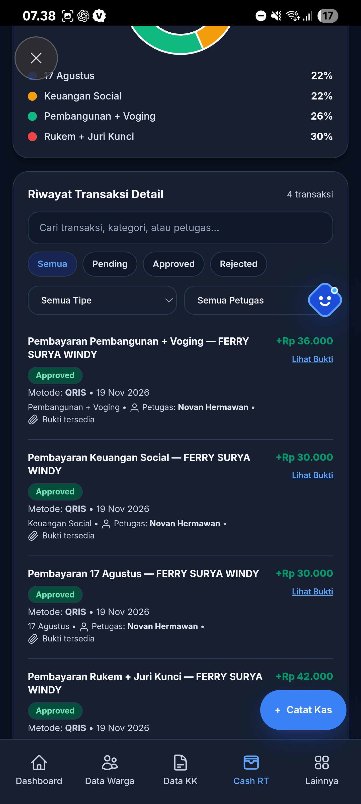
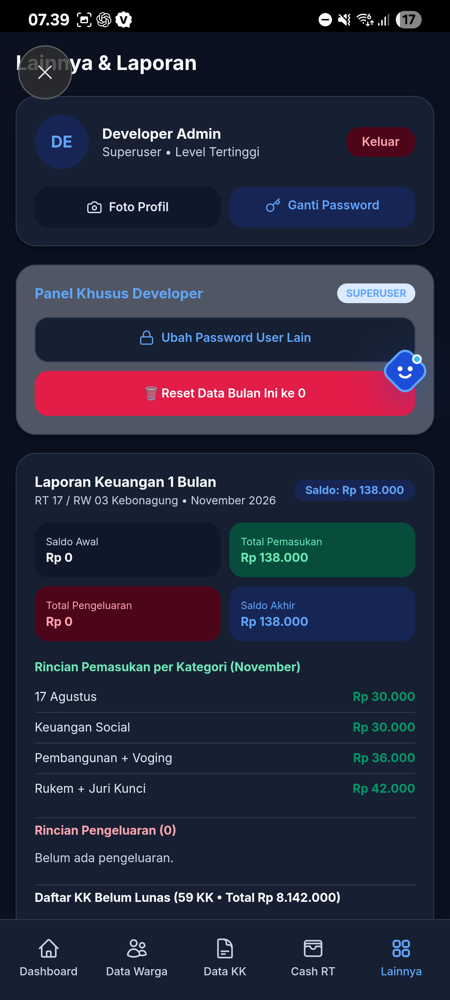
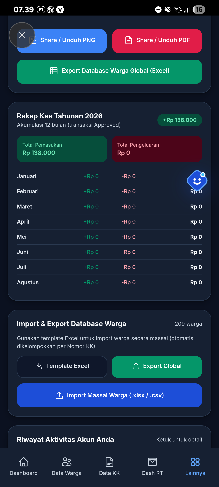

# WargaKITA — Aplikasi Administrasi & Keuangan RT 17 / RW 03 Kebonagung

**WargaKITA** (`v1.14.1`) adalah aplikasi Android & Web bergaya **Flat UI** untuk pengelolaan data kependudukan, iuran bulanan warga, kas RT, agenda kegiatan, asisten AI **NawakAI**, dan pelaporan keuangan **RT 17 / RW 03 Kebonagung, Malang**, terintegrasi secara *real-time* dengan **Supabase** (Auth, PostgreSQL + RLS, Storage, dan Edge Functions).

---

## Fitur & Fungsi Utama (v1.14.1)

### 1. Dashboard Utama, Ringkasan KPI & Grafik Pemasukan
Menampilkan sapaan sesuai waktu, identifikasi wilayah **RT 17 / RW 03 Kebonagung**, logo **WargaKITA** tersemat langsung (Base64) agar selalu tampil utuh, tombol notifikasi lonceng, serta **4 kartu KPI utama** (*Total KK*, *Total Warga*, *Saldo Kas RT*, dan *Total Tunggakan* bulan berjalan). Di bawahnya tersedia **Grafik Pemasukan 6 Bulan** untuk memantau tren setoran iuran dan kas RT secara visual, serta ikon melayang **NawakAI** (Wajik Biru) yang dapat digeser bebas (*draggable*) dan posisinya tersimpan otomatis.

---

### 2. Kalender Kegiatan Warga, Agenda Resmi RT & Pengingat HP Berkala
Menyajikan kalender interaktif bulanan yang membedakan **Agenda Resmi RT** (titik biru) dan **Ulang Tahun Kepala Keluarga Permanen** (titik oranye). Setiap agenda resmi dilengkapi tombol **Simpan ke HP** (sinkronisasi langsung ke Kalender Android `CalendarContract` dengan pengingat 60 & 15 menit sebelumnya), **Edit**, dan **Hapus**. Aplikasi juga mengirim notifikasi HP Android otomatis untuk **Agenda Resmi RT (H-3 hingga H-0)**, **Ulang Tahun Kepala Keluarga**, serta pengingat **Pending Approval minimal 1 jam sekali** bagi **Pak RT**, **Wakil RT**, dan **Developer**. Pada bagian **Ulang Tahun Warga RT 17**, pengurus dapat langsung menekan tombol **Kartu** untuk membuat ucapan ulang tahun.

---

### 3. Kartu Ucapan Ulang Tahun Warga (Flat UI 3 Tema)
Modal khusus untuk membuat kartu ucapan ulang tahun bagi **Kepala Keluarga (Permanen)** lengkap dengan nama, usia otomatis, dan pesan ucapan yang dapat disesuaikan. Tersedia **3 pilihan tema Flat UI** (*Biru RT 17*, *Navy Emas*, dan *Hijau Segar*) dengan ilustrasi kue ulang tahun dan konfeti vektor, tombol **Bagikan / Unduh Gambar Kartu (PNG)**, serta tombol **Kirim Ucapan ke WhatsApp Warga** (`wa.me`) satu ketuk.

---

### 4. NawakAI — Beranda Asisten Pintar & Gelembung Sapaan Mengikuti Posisi
Membuka ikon Wajik Biru akan menampilkan **Beranda NawakAI** terlebih dahulu (dilengkapi pengaman *anti ghost-click* `320ms` agar pertanyaan tidak terklik otomatis saat dibuka). Di beranda tersedia kartu pertanyaan cepat, *quick chips* (**Ringkasan Kas**, **Cek Tunggakan**, **Export Warga**, **Kartu Ultah**), tombol ikon klip lampiran (khusus role **Developer Admin** dan **Pak RT**), sakelar **Speaker On/Mute** (`🔊/🔇`), serta indikator status NawakAI. Di luar jendela chat, NawakAI menampilkan gelembung sapaan (*speech bubble*) kontekstual sesuai waktu (*Pagi*, *Siang*, *Sore*, *Malam*), situasi RT terkini, serta tips interaktif saat pengguna mendata di tab **Data Warga**, **Data KK**, atau **Cash RT** — dan gelembung tersebut **otomatis bergerak mengikuti posisi ikon NawakAI** saat digeser.

---

### 5. NawakAI — 6 Ekspresi Lucu, Efek Suara Unik & Suara Bahasa Jawa
Maskot **Wajik Biru NawakAI** kini hidup dengan **6 ekspresi wajah dinamis**, **efek suara sintesis ringan (*Web Audio Synth*)** yang berbeda di setiap kejadian, serta **suara bicara bahasa Jawa-Malangan otomatis** melalui Android `TextToSpeech` (`speakJavanese`) setiap kali *welcome message* maupun *popup* tips muncul:
- **Welcome Ceria (*"Ting-tong-bloop!"* + Suara Jawa):** Mata melengkung senang & senyum lebar saat menyapa Pagi/Siang/Sore/Malam atau memberi tips interaktif.
- **Lagi Mikir (*"Hmm-tick"*):** Mata sipit berpikir & kilau biru berkedip saat NawakAI memproses pertanyaan.
- **Selesai & Bangga (*"Ding-spark!"*):** Mata bintang & senyum lebar saat jawaban selesai disusun.
- **Kaget Pending Approval (*"Triing-koing!"*):** Mata melotot kaget, tetes keringat, & lencana **`!`** saat ada transaksi menunggu persetujuan.
- **Pesta Ultah & Agenda (*"Ta-da!"*):** Mata kedip (*wink*), topi pesta mini, & konfeti saat ada ulang tahun Kepala Keluarga atau agenda RT terdekat.
- **Siaga Update (*"Beep-boop-up!"*):** Alis fokus & lencana panah ke atas (`↑`) saat versi APK terbaru tersedia.

---

### 6. NawakAI — Timeline ala Gemini, Memori Chat, Scan KK/PDF & Export 4 Format
Didukung oleh **Gemini AI** melalui Supabase Edge Function `nawak-ai` dengan *silent fallback* mulus ke mesin lokal + **OCR Resolusi Tinggi (*Tesseract.js + PDF.js*)** tanpa kuota API. Saat memproses pertanyaan, NawakAI menampilkan *timeline* langkah *real-time* tanpa border kotak (**100% bergaya Gemini**) hingga ditutup status **`✓ Selesai`**, serta membaca **seluruh database RT 17** secara *real-time* tanpa batasan 15 KK dan mengingat **riwayat serta memori chat per pengguna**. Fitur utamanya meliputi:
- **Tanya Data RT & Alamat Secara Cerdas:** Ringkasan kas, rincian status iuran (Hijau/Kuning/Merah), cari warga/alamat (termasuk filter alamat spesifik), petugas penagih, rekap kas 12 bulan, dan draf WA.
- **Import & Compare Scan KK (PNG/JPG/PDF) maupun Excel/CSV:** Lampiran ditahan dulu di kotak pratinjau sebelum dikirim sesuai perintah; hasil pembacaan otomatis dicocokkan (*fuzzy compare*) terhadap database WargaKITA agar data yang sudah ada tidak diinput ganda, sedangkan data baru siap diinput dengan persetujuan pengguna.
- **Export Data Warga 4 Format Lengkap:** Mengekspor seluruh data warga dengan format 7 kolom lengkap yang identik dengan Menu Lainnya (`No / Anggota`, `Alamat`, `Nomor KK`, `NIK`, `Hubungan Keluarga`, `No. HP`, `Status`) ke pilihan **PNG**, **Excel (`.xlsx`)**, **Word (`.doc`)**, dan **PDF**.

---

### 7. Data Warga — Direktori Lengkap & Pencarian Cepat
Menampilkan seluruh daftar warga RT 17 dengan kolom pencarian real-time berdasarkan **nama, NIK, nomor KK, alamat, atau nomor HP**, serta filter berdasarkan **Agama**. Setiap kartu warga menampilkan inisial, nama lengkap, status tinggal, nomor KK, hubungan keluarga, serta alamat terbaru yang tersinkronisasi penuh dengan data KK saat diedit.

---

### 8. Data Warga — Filter Status Tinggal Berwarna Kontras
Mempermudah pemetaan status kependudukan melalui tab filter dengan warna aktif yang kontras di mode terang maupun gelap: **Semua** (biru), **Permanen** (hijau), **Kontrak** (oranye/amber), **Kost** (biru muda), dan **Pindah Domisili** (merah). Warga berstatus **Pindah Domisili** otomatis dikecualikan dari tagihan bulanan (**Tanpa Tagihan**).

---

### 9. Tambah Data Warga Baru (1 KK) & Warga Lama (KK Ada)
Formulir input kependudukan yang dipisah antara **Warga Baru (1 KK)** untuk mendaftarkan satu keluarga penuh sekaligus banyak anggota dalam satu kali simpan, dan **Warga Lama (KK Ada)** untuk menambah anggota ke KK yang sudah terdaftar. Mendukung pilihan hubungan keluarga lengkap (`Kepala Keluarga`, `Suami`, `Istri`, `Pasangan`, `Anak`, `Orang Tua`, `Mertua`, `Menantu`, `Cucu`, `Famili Lain`, `Lainnya`) serta tampilan responsif agar kolom ketik tidak tertutupi keyboard Android.

---

### 10. Data KK & Status Pembayaran Iuran Bulanan
Daftar seluruh **Kepala Keluarga** diurutkan secara alfabetis (A–Z) lengkap dengan indikator warna status iuran bulan berjalan: **Semua**, **Hijau** (Lunas), **Kuning** (Sebagian), **Merah** (Belum Bayar), dan **Tanpa Tagihan**. Mengetuk kartu KK akan membuka **Detail KK** beserta daftar anggota keluarga, alamat tersinkronisasi, dan tombol **Telepon** (`tel:`) serta **WhatsApp** (`wa.me`) langsung ke nomor Kepala Keluarga.

---

### 11. Catat Pembayaran Iuran, 4 Petugas Bendahara Khusus & QRIS
Formulir pencatatan iuran bulanan per KK yang mendukung opsi **Bayar Keseluruhan Tagihan (Semua Kategori)** atau per kategori individual, metode **QRIS (a.n. Fibriono — Ketua RT 17)** / **Transfer Bank** / **Tunai**, serta unggah foto bukti pembayaran dari **Galeri** atau **Foto Langsung** kamera ke Supabase Storage. Khusus 4 akun **Bendahara RT**, kategori dan nama petugas otomatis terisi serta terkunci sesuai tugas masing-masing:
- **Novan Hermawan** (`novan@wargakita.id`) → **17 Agustus**
- **Ahmad Abin** (`ahmadabin@wargakita.id`) → **Keuangan Social**
- **A. Teguh Purwanto** (`teguh@wargakita.id`) → **Pembangunan + Voging**
- **Jodik Purwanto** (`jodik@wargakita.id`) → **Rukem + Juri Kunci**

---

### 12. Cash RT — Ringkasan Saldo, Saldo Awal & Grafik Kategori
Menampilkan posisi **Saldo Kas Saat Ini**, rincian total **Pemasukan** dan **Pengeluaran** bulan berjalan, tombol **Edit Saldo Awal** (khusus Developer & Pak RT), serta **Grafik Donat** proporsi pemasukan atau pengeluaran per kategori secara interaktif.

---

### 13. Cash RT — Riwayat Transaksi Detail & Filter Persetujuan
Menyajikan daftar lengkap seluruh transaksi kas RT dengan pencarian teks (transaksi, kategori, petugas, metode), filter status (**Semua**, **Pending**, **Approved**, **Rejected**), filter tipe (**Pemasukan**, **Pengeluaran**), dan filter **Nama Petugas**. Setiap kartu menampilkan lencana status persetujuan, nama petugas pemeriksa, indikator **Bukti tersedia**, tombol **Lihat Bukti** lintas perangkat, serta pop-up **Detail Transaksi** saat diketuk.

---

### 14. Catat Transaksi Kas RT & Unggah Bukti Nota
Modal pencatatan pemasukan atau pengeluaran kas umum RT (di luar iuran KK) dengan pilihan tipe **Pengeluaran** atau **Pemasukan**, pemilihan kategori, nominal, keterangan, petugas pemeriksa (otomatis terisi & terkunci untuk akun Bendahara khusus), serta unggah foto nota/bukti transaksi ke Supabase Storage (`receipts`). Transaksi yang dicatat oleh **Bendahara RT** atau **Sekretaris RT** otomatis berstatus **Pending Approval** hingga disetujui oleh **Pak RT**, **Wakil RT**, atau **Developer Admin**.

---

### 15. Tab Lainnya — Kartu Edit Profil, Panel Developer & Laporan Keuangan 1 Bulan
Menampilkan kartu profil akun pengguna yang sedang login lengkap dengan tombol **Foto**, **Edit Profil** (ubah Nama Tampilan, No. HP/WhatsApp, dan Jabatan yang tersinkronisasi melalui Supabase Auth), **Password**, dan **Keluar**. Khusus akun `developer@wargakita.id`, tersedia **Panel Khusus Developer** berisi **Ubah Password User Lain** (mencakup semua role termasuk 4 akun Bendahara baru) dan **Reset Data Bulan Ini ke 0**. Di bawahnya terdapat ringkasan **Laporan Keuangan 1 Bulan** yang siap dibagikan.

---

### 16. Rekap Kas Tahunan, Import/Export Database Warga & Riwayat Aktivitas
Berisi tombol ekspor laporan **Share / Unduh PNG** dan **Share / Unduh PDF**, **Export Database Warga Global**, kartu **Rekap Kas Tahunan** (akumulasi pemasukan, pengeluaran, dan selisih bersih 12 bulan Januari–Desember), menu **Import & Export Database Warga** (unduh Template Excel `.xlsx` & import massal), serta daftar **Riwayat Aktivitas Akun Anda** yang dapat diketuk untuk melihat detail aktivitas.

---

### 17. Pengaturan Tema (Terang/Gelap/Device) & Wajib Update APK Otomatis
Menyediakan pengaturan **Tampilan & Tema Aplikasi** (**Terang**, **Gelap**, atau **Device** yang mengikuti tema sistem Android secara *real-time* dengan palet Flat UI kontras tinggi). Pada bagian paling bawah ditampilkan informasi versi aplikasi terpasang (`v1.14.1`), tombol **Unduh APK Terbaru (GitHub Release)**, dan tombol **Cek Update Aplikasi**. Saat rilis baru tersedia di GitHub Releases, aplikasi langsung mengirimkan **notifikasi HP Android** dan menampilkan pop-up **Wajib Update** lengkap dengan rincian *changelog* terbaru (APK rilis ditandatangani dengan *keystore* permanen sehingga pembaruan langsung menimpa versi lama tanpa *uninstall*).

---

## Matriks Hak Akses

| Role | Email Login | Lihat Warga | Tambah Warga | Edit / Hapus Warga | Catat Bayar & Kas | Approval Transaksi | Kalender & Saldo Awal | Import NawakAI | Panel Developer |
| :--- | :--- | :---: | :---: | :---: | :---: | :---: | :---: | :---: | :---: |
| **Developer Admin** | `developer@wargakita.id` | Ya | Ya | Ya | Ya (Auto-Approved) | Ya | Ya | Ya | Ya |
| **Pak RT** | `pakrt17@wargakita.id` | Ya | Ya | Ya | Ya (Auto-Approved) | Ya | Ya | Ya | Tidak |
| **Wakil RT** | `wakilrt17@wargakita.id` | Ya | Ya | Hapus saja | Tidak | Ya | Kalender saja | Tidak | Tidak |
| **Bendahara Umum / Khusus** | `bendahara17@wargakita.id`, `novan@wargakita.id`, `ahmadabin@wargakita.id`, `teguh@wargakita.id`, `jodik@wargakita.id` | Ya | Tidak | Tidak | Ya (Pending Approval) | Tidak | Tidak | Tidak | Tidak |
| **Sekretaris RT** | `sekretaris17@wargakita.id` | Ya | Ya | Tidak | Tidak | Tidak | Tidak | Tidak | Tidak |

---

## Cara Kerja & Arsitektur Sistem

1. **Autentikasi & Keamanan:** Login via Supabase Auth (layar login dilengkapi ikon **mata dicoret** untuk melihat/menyembunyikan password), wajib ganti password pada login pertama, dan seluruh tabel dilindungi **Row Level Security (RLS)**.
2. **Alur Persetujuan (*Pending Approval*):** Setiap pencatatan pemasukan maupun pengeluaran oleh **Bendahara RT** atau **Sekretaris RT** otomatis berstatus **Pending Approval** hingga disetujui oleh **Pak RT**, **Wakil RT**, atau **Developer** (dilengkapi pengingat notifikasi HP minimal 1 jam sekali).
3. **Penyimpanan Bukti di Supabase Storage:** Foto bukti diunggah ke bucket `receipts` dengan struktur `TAHUN/BULAN/PEMASUKKAN|PENGELUARAN/` dan format nama terstandar (`Pemasukkan_Tanggal_NamaWarga` / `Lainnya_Nominal_NamaPemasukkan` / `Pengeluaran_Nominal_NamaPengeluaran`).
4. **Asisten AI Hibrida & Suara (`nawak-ai` + OCR Lokal + TTS):** Permintaan chat dikirim ke Supabase Edge Function `nawak-ai`. Jika API eksternal sedang sibuk/kuota habis, aplikasi otomatis beralih ke mesin lokal berbahasa Jawa-Malangan dan OCR lokal (`Tesseract.js` + `PDF.js`) tanpa menampilkan pesan error teknis, disertai efek suara *Web Audio Synth* dan suara bicara `TextToSpeech` Android.
5. **Build & Rilis APK Otomatis:** GitHub Actions (`.github/workflows/build-apk.yml`) mengekstrak `WargaKITA_GitHub_Backup.zip`, menandatangani APK rilis menggunakan *keystore* permanen dari GitHub Secrets, dan mempublikasikannya ke **GitHub Releases**.

---

## Riwayat Perubahan (Changelog)
Lihat catatan lengkap dan mendetail untuk setiap versi pada file [CHANGELOG.md](CHANGELOG.md).
