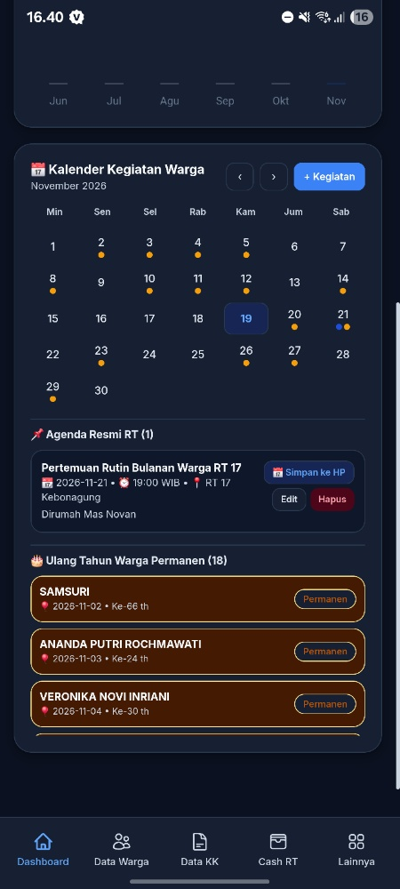
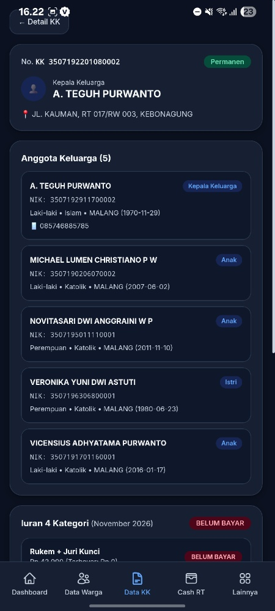
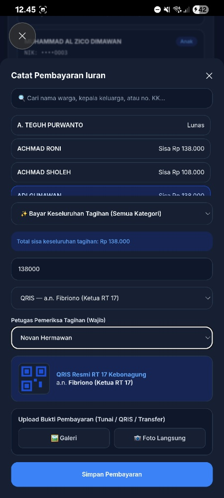
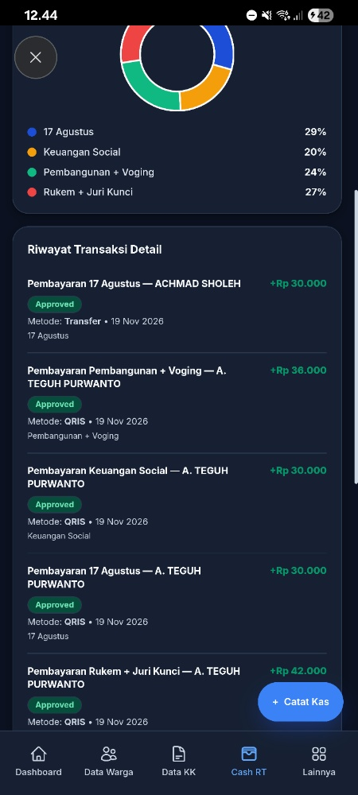
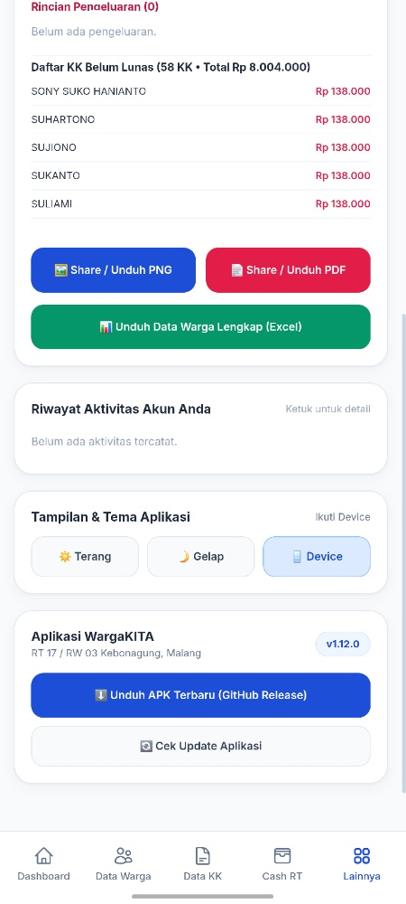

# WargaKITA — Aplikasi Administrasi & Keuangan RT 17 / RW 03 Kebonagung

**WargaKITA** (`v1.13.3`) adalah aplikasi Android & Web bergaya **Flat UI** untuk pengelolaan data kependudukan, iuran bulanan warga, kas RT, agenda kegiatan, dan pelaporan keuangan **RT 17 / RW 03 Kebonagung, Malang**, terintegrasi secara *real-time* dengan **Supabase** (Auth, PostgreSQL + RLS, dan Storage).

---

## Galeri Tampilan Mobile

| Dashboard & Kalender RT 17 | Data Warga (Filter Warna Status) | Detail KK & Anggota |
| :---: | :---: | :---: |
|  |  |  |

| Catat Pembayaran & Petugas | Cash RT & Riwayat Transaksi | Laporan, Tema & Update |
| :---: | :---: | :---: |
|  |  |  |

---

## Fitur & Fungsi Utama (v1.13.3)

### 1. Dashboard, Kalender Kegiatan & Ulang Tahun Warga RT 17
- **Ringkasan Keuangan & Kependudukan:** Menampilkan total KK aktif, total warga aktif, saldo kas RT terkini, dan total tunggakan bulan berjalan.
- **Grafik Pemasukan 6 Bulan:** Visualisasi tren pemasukan iuran dan kas RT.
- **Agenda Resmi RT & Sinkronisasi Kalender HP:** Tombol **Simpan ke HP** pada setiap agenda langsung menyimpan acara ke Kalender Android (`CalendarContract`) beserta pengingat otomatis (60 & 15 menit sebelum acara), ditambah notifikasi pengingat HP untuk kegiatan hari ini/besok.
- **Ulang Tahun Warga RT 17:** Bagian terpisah dengan desain Flat UI yang menampilkan ulang tahun **Kepala Keluarga** berstatus **Permanen** per bulan (ditandai titik oranye pada kalender).

### 2. Data Warga
- **Direktori & Filter Warna Kontras:** Pencarian nama, NIK, nomor KK, alamat, atau nomor HP, dilengkapi filter agama serta filter status tinggal dengan warna aktif yang kontras (**Semua** biru, **Permanen** hijau, **Kontrak** oranye, **Kost** biru muda, **Pindah Domisili** merah).
- **Tambah Warga Baru (1 KK) & Warga Lama (KK Ada):** Input 1 Kartu Keluarga sekaligus banyak anggota keluarga (mendukung status `Kepala Keluarga`, `Suami`, `Istri`, `Pasangan`, `Anak`, `Orang Tua`, `Mertua`, `Menantu`, `Cucu`, `Famili Lain`, `Lainnya`).
- **Edit & Pindah Domisili:** Warga berstatus **Pindah Domisili** otomatis menjadi **Tanpa Tagihan**; KK kosong (`0 anggota`) otomatis dibersihkan saat seluruh anggotanya dihapus.

### 3. Data KK & Iuran Bulanan
- **Detail KK dengan Tombol Telepon & WhatsApp:** Kartu Kepala Keluarga dilengkapi tombol **Telepon** (`tel:`) dan **WhatsApp** (`https://wa.me/`) berikon Flat UI minimalis yang langsung membuka aplikasi Dialer atau WhatsApp ke nomor tujuan.
- **Catat Pembayaran Iuran:** Pencarian KK A–Z, opsi **Bayar Keseluruhan Tagihan (Semua Kategori)** atau per kategori, metode **QRIS (a.n. Fibriono — Ketua RT 17)** / **Transfer** / **Tunai**, pilihan wajib **Petugas Pemeriksa Tagihan (A–Z)** (`A. Teguh Purwanto`, `Ahmad Abin`, `Jodik Purwanto`, `Novan Hermawan`), dan foto bukti via kamera langsung atau galeri.

### 4. Cash RT & Persetujuan Transaksi
- **Filter & Pencarian Lanjutan:** Pencarian teks (transaksi, kategori, petugas, metode), filter status (`Semua`, `Pending`, `Approved`, `Rejected`), filter tipe (`Pemasukan`, `Pengeluaran`), dan filter nama petugas.
- **Riwayat Transaksi Detail & Pop-up:** Menampilkan status persetujuan, nama petugas penginput (khusus Bendahara & Sekretaris), tombol **Lihat Bukti** lintas perangkat, dan pop-up **Detail Transaksi**.

### 5. Lainnya, Rekap Tahunan, Import/Export, Tema & Auto-Update
- **Laporan Keuangan 1 Bulan & Rekap Kas Tahunan (12 Bulan):** Ringkasan bulanan siap ekspor (**Share / Unduh PNG**, **Share / Unduh PDF**) serta kartu **Rekap Kas Tahunan** Januari–Desember.
- **Import & Export Massal Database Warga:** Unduh **Template Excel (`.xlsx`)**, **Export Database Warga Global**, dan **Import Massal Warga (`.xlsx` / `.csv`)** otomatis per Nomor KK.
- **Riwayat Aktivitas Akun:** Aktif untuk semua role login dan dapat diketuk untuk melihat pop-up detail aktivitas.
- **Tema Aplikasi (Terang, Gelap, Ikuti Device):** Mode gelap Flat UI kontras tinggi serta deteksi tema perangkat Android secara *real-time*.
- **Cek Update Otomatis & Signing Keystore Permanen:** Pembaruan APK dari **GitHub Releases** langsung menimpa versi sebelumnya tanpa *uninstall*.

---

## Matriks Hak Akses (5 Role)

| Role | Email Login | Lihat Warga | Tambah Warga | Edit / Hapus Warga | Catat Bayar & Kas | Approval Transaksi | Kalender & Saldo Awal | Panel Developer |
| :--- | :--- | :---: | :---: | :---: | :---: | :---: | :---: | :---: |
| **Developer Admin** | `developer@wargakita.id` | Ya | Ya | Ya | Ya (Auto-Approved) | Ya | Ya | Ya |
| **Pak RT** | `pakrt17@wargakita.id` | Ya | Ya | Ya | Ya (Auto-Approved) | Ya | Ya | Tidak |
| **Wakil RT** | `wakilrt17@wargakita.id` | Ya | Ya | Hapus saja | Tidak | Ya | Kalender saja | Tidak |
| **Bendahara RT** | `bendahara17@wargakita.id` | Ya | Tidak | Tidak | Ya (Pending Approval) | Tidak | Tidak | Tidak |
| **Sekretaris RT** | `sekretaris17@wargakita.id` | Ya | Ya | Tidak | Tidak | Tidak | Tidak | Tidak |

---

## Cara Kerja & Alur Sistem

1. **Autentikasi & Keamanan:** Login via Supabase Auth (layar login dilengkapi ikon mata bercentang untuk melihat password), wajib ganti password pada login pertama, dan seluruh tabel dilindungi **Row Level Security (RLS)**.
2. **Alur Persetujuan (*Pending Approval*):** Setiap pencatatan pemasukan maupun pengeluaran oleh **Bendahara RT** atau **Sekretaris RT** wajib memilih **Nama Petugas** dan otomatis berstatus **Pending Approval** hingga disetujui oleh **Pak RT**, **Wakil RT**, atau **Developer**.
3. **Penyimpanan Bukti di Supabase Storage:** Foto bukti diunggah ke bucket `receipts` dengan struktur `TAHUN/BULAN/PEMASUKKAN|PENGELUARAN/` dan format nama `Pemasukkan_Tanggal_NamaWarga` / `Lainnya_Nominal_NamaPemasukkan` / `Pengeluaran_Nominal_NamaPengeluaran`.
4. **Build & Rilis APK Otomatis:** GitHub Actions (`.github/workflows/build-apk.yml`) mengekstrak `WargaKITA_GitHub_Backup.zip`, menandatangani APK rilis menggunakan *keystore* permanen dari GitHub Secrets, dan mempublikasikannya ke **GitHub Releases**.

---

## Riwayat Perubahan (Changelog)
Lihat catatan lengkap perubahan per versi pada file [CHANGELOG.md](CHANGELOG.md).
