# WargaKITA — Aplikasi Administrasi & Keuangan RT 17 / RW 03 Kebonagung

**WargaKITA** (`v1.15.3`) adalah aplikasi **Android & Web** bergaya **Flat UI** untuk pengelolaan data kependudukan, iuran bulanan warga, kas RT, agenda kegiatan, asisten AI **NawakAI**, dan pelaporan keuangan **RT 17 / RW 03 Kebonagung, Pakisaji, Malang**, terintegrasi secara *real-time* dengan **Supabase** (Auth, PostgreSQL + RLS, Storage, dan Edge Functions).

---

## Daftar Isi
1. [Tab Dashboard & Kalender Warga](#1-tab-dashboard--kalender-warga)
2. [Asisten AI — NawakAI](#2-asisten-ai--nawak-ai)
3. [Tab Data Warga](#3-tab-data-warga)
4. [Tab Data KK & Iuran](#4-tab-data-kk--iuran)
5. [Tab Cash RT](#5-tab-cash-rt)
6. [Tab Lainnya, Laporan & Pengaturan](#6-tab-lainnya-laporan--pengaturan)
7. [Panel Khusus Developer & Manajemen User](#7-panel-khusus-developer--manajemen-user)
8. [Matriks Hak Akses & Arsitektur Sistem](#8-matriks-hak-akses--arsitektur-sistem)

---

## 1. Tab Dashboard & Kalender Warga

  
  
  
  

Tab **Dashboard** berfungsi sebagai pusat kendali cepat bagi pengurus RT untuk memantau kondisi administrasi dan keuangan secara sekilas saat pertama kali membuka aplikasi:

- **Header Identitas & Notifikasi:** Menampilkan salam sesuai waktu, identitas wilayah **RT 17 / RW 03 Kebonagung**, logo **WargaKITA** tersemat langsung (Base64), dan tombol lonceng notifikasi (*Pending Approval*, agenda terdekat, dan pembaruan aplikasi). Mendukung gestur *Pull-to-Refresh* untuk menyegarkan data dari Supabase kapan saja.
- **4 Kartu KPI Utama & Grafik Pemasukan 6 Bulan:** Menyajikan **Total KK Aktif**, **Total Warga Aktif**, **Saldo Kas RT (Approved)**, dan **Total Tunggakan** bulan berjalan, lengkap dengan grafik batang tren pemasukan 6 bulan terakhir.
- **Kalender Kegiatan Warga & Pengingat Otomatis:** Membedakan **Agenda Resmi RT** (titik biru) dan **Ulang Tahun Kepala Keluarga Permanen** (titik oranye). Setiap agenda dilengkapi tombol **Simpan ke HP** (sinkronisasi ke Kalender Android `CalendarContract` dengan pengingat 60 & 15 menit sebelumnya), **Edit**, dan **Hapus** (dengan pop-up konfirmasi *frosted-blur*). Aplikasi juga mengirim notifikasi HP Android dan pengingat berkala untuk Agenda RT (H-3 s.d. H-0), Ulang Tahun Warga (maksimal 1×/hari), serta *Pending Approval* (minimal 1 jam sekali).
- **Kartu Ucapan Ulang Tahun (3 Tema Flat UI + 6 Template Sesuai Usia):** Tersedia 3 pilihan tema (*Biru RT 17*, *Navy Emas*, *Hijau Segar*) dan dropdown **6 template ucapan** (*Resmi & Hangat*, *Hormat & Doa Sesepuh ≥55 Th*, *Santai Usia Muda*, *Lucu Malangan*, *Lucu Awet Muda*, *Islami*) yang otomatis menyesuaikan usia warga, lengkap dengan tombol **Bagikan / Unduh PNG** dan **Kirim ke WhatsApp**.

---

## 2. Asisten AI — NawakAI

  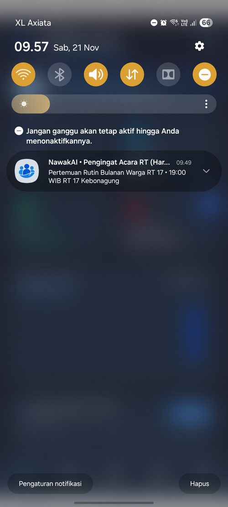
  
  
  

  
  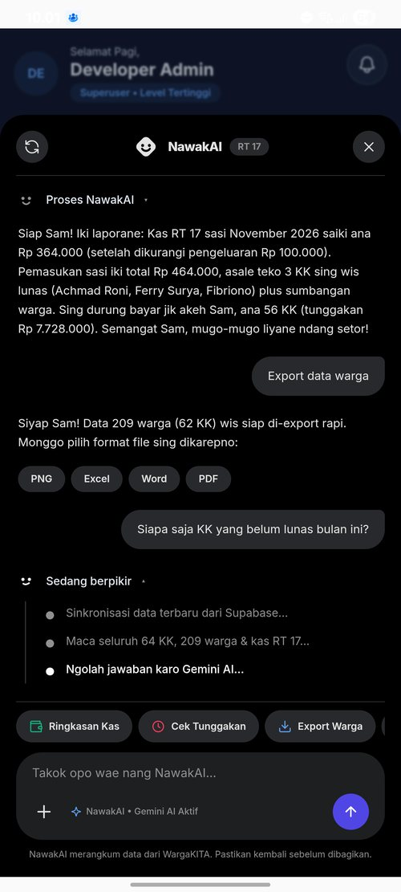
  

**NawakAI** adalah asisten AI interaktif RT 17 berbentuk maskot **Wajik Biru** melayang yang dapat digeser bebas (*draggable*, posisi tersimpan otomatis) dan dirancang dengan **antarmuka bergaya Gemini**:

- **Tampilan Chat & Header Bergaya Gemini:** Mendukung Tema Terang dan OLED Gelap (`#000000`, *bubble* user `#28292c`, kapsul input `#1e1f20`), ikon resmi **Wajik NawakAI + `NawakAI RT 17`** di tengah header yang menyesuaikan tema, pengaman *anti ghost-click* `320ms`, serta sakelar **Speaker On/Mute (`🔊/🔇`)**.
- **6 Ekspresi Dinamis & 7 Rekaman Suara ElevenLabs (*Offline*):** Maskot Wajik Biru memiliki 6 ekspresi (*Welcome*, *Mikir*, *Bangga*, *Kaget Pending*, *Pesta Ultah/Agenda*, *Siaga Update*) dan 7 audio ElevenLabs berbahasa Jawa-Malangan yang sinkron dengan zona waktu **WIB (`Asia/Jakarta`) Malang** (**04.00–10.59** *Sugeng enjang*, **11.00–16.59** *Sugeng siang*, **17.00–03.59** *Sugeng dalu*). Gelembung tips di tab *Data Warga* bersuara maksimal **1×24 jam**, sedangkan tab *Data KK* & *Cash RT* tampil tenang tanpa suara dengan jeda popup global 2 jam & per-tab 6 jam.
- **Animasi Loader & Timeline Proses Presisi:** Menampilkan ikon wajah mata berkedip + senyum putih saat berpikir, garis vertikal `1px` dengan kontras teks langkah selesai vs aktif hingga centang **`Selesai`** yang sejajar presisi, serta fitur *minimize/expand* (`▾/▴`) untuk pesan user panjang (>4 baris).
- **Input Multi-Baris & Lampiran Semua Jenis File:** Kotak ketik `<textarea>` transparan dengan *placeholder* bahasa Jawa (`Takok opo wae nang NawakAI...`, tombol `Enter` membuat baris baru), tombol **`+`** dengan pratinjau di dalam kapsul input, dan dukungan membaca **PNG, JPG, WEBP, PDF (hingga 10 halaman + OCR lokal), Excel/CSV/ODS (seluruh sheet), Word (`.docx`/`.doc`), serta TXT/MD/JSON/XML/LOG**. NawakAI menyajikan data, merangkum isi file secara detail, mendeteksi data warga/KK siap import (anti-duplikat), mengekspor data warga ke **4 format (PNG, Excel, Word, PDF)**, dan menjalankan mutasi database terkonfirmasi (pelunasan KK, ACC massal, hapus warga) khusus *Developer*, *Pak RT*, dan *Wakil RT*.

---

## 3. Tab Data Warga

  
  
  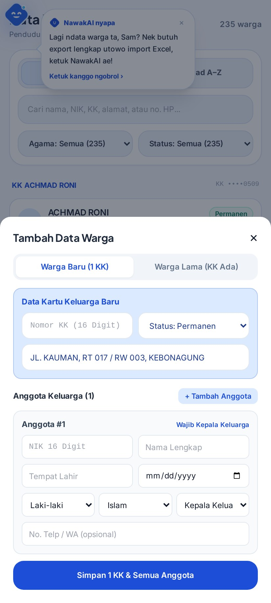
  
  
  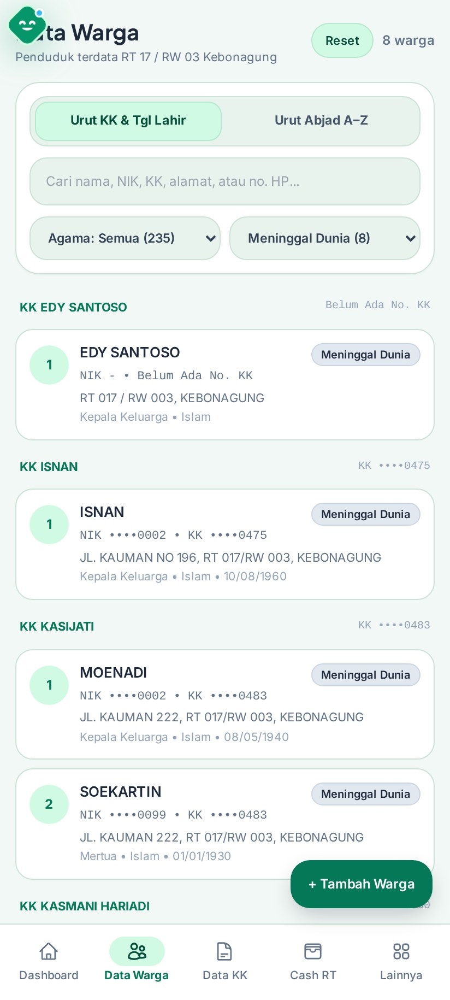

Tab **Data Warga** mengelola seluruh direktori penduduk RT 17 secara terpusat dan tersinkronisasi penuh dengan data Kartu Keluarga:

- **Pencarian Real-Time & Filter Ganda:** Mencari warga berdasarkan **Nama, NIK, Nomor KK, Alamat, atau No. HP**, disertai filter **Agama** (*Semua, Islam, Kristen, Hindu, Buddha*) dan tab filter **Status Kependudukan** berwarna kontras (*Semua, Permanen, Kontrak, Kost, Pindah Domisili, Meninggal Dunia*).
- **Tambah Data Warga Baru (1 KK) & Warga Lama (KK Ada):** Memisahkan pendaftaran keluarga baru (bisa langsung menginput banyak anggota dalam satu KK sekaligus) dari penambahan anggota baru ke KK yang sudah terdaftar, lengkap dengan pilihan hubungan keluarga (`Kepala Keluarga`, `Suami`, `Istri`, `Pasangan`, `Anak`, `Orang Tua`, `Mertua`, `Menantu`, `Cucu`, `Famili Lain`, `Lainnya`).
- **Tinjau, Edit & Hapus Warga:** Mengetuk kartu warga membuka modal detail/edit (dengan daftar anggota keluarga lain dalam satu KK untuk berpindah cepat). Mendukung pembaruan alamat yang otomatis tersinkron ke tabel `households`, penandaan status **`Meninggal Dunia`** atau **`Pindah Domisili`** (otomatis mengecualikan dari tagihan bulanan), serta hapus warga dengan konfirmasi bertingkat.

---

## 4. Tab Data KK & Iuran

  
  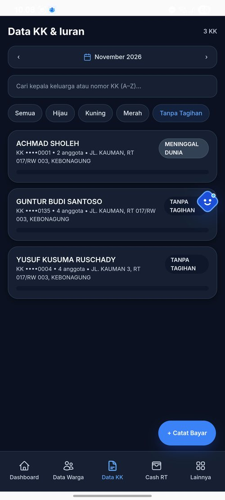
  
  
  
  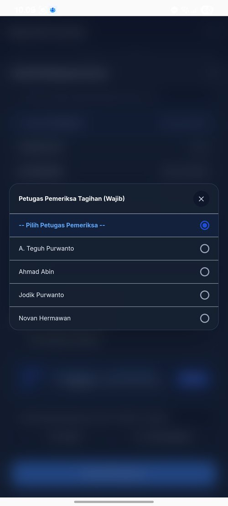
  

Tab **Data KK & Iuran** berfokus pada pemantauan status iuran bulanan setiap Kepala Keluarga (diurutkan alfabetis A–Z) serta pencatatan pembayarannya:

- **Pemantau Status Iuran Bulanan & Filter Warna:** Dilengkapi pemilih bulan/tahun, pencarian Kepala Keluarga/No. KK, dan filter cepat: **Hijau** (*Lunas*), **Kuning** (*Sebagian*), **Merah** (*Belum Bayar*), dan **Tanpa Tagihan** (*Pindah Domisili* maupun **`MENINGGAL DUNIA`** dengan lencana `.wk-badge-deceased` yang kontras di mode Terang & Gelap).
- **Halaman Detail KK & Kontak Langsung:** Menampilkan nomor KK, status tinggal, alamat tersinkronisasi, daftar seluruh anggota keluarga beserta status masing-masing (*Kepala Keluarga*, *Istri*, *Pindah Domisili*, atau *Meninggal Dunia*), rincian 4 kategori iuran (`Rukem + Juru Kunci`, `17 Agustus`, `Keuangan Social`, `Pembangunan + Fogging`), serta tombol **Telepon (`tel:`)** dan **WhatsApp (`wa.me`)** satu ketuk.
- **Catat Pembayaran Iuran, QRIS Layar Penuh & Tugas Bendahara:** Mendukung bayar **Semua Kategori sekaligus** atau per kategori, metode **QRIS**, **Transfer Bank**, dan **Tunai**, serta unggah bukti foto dari Galeri/Kamera ke Supabase Storage. Memilih **QRIS** langsung membuka layar penuh ala perbankan untuk **DANA `085607686867` a.n. `FIBRIONO`** dan otomatis menaikkan kecerahan layar HP Android ke 100% (`setMaxScreenBrightness`). Khusus 4 akun Bendahara RT, kategori & nama petugas otomatis terisi dan terkunci sesuai tugas masing-masing.

---

## 5. Tab Cash RT

  
  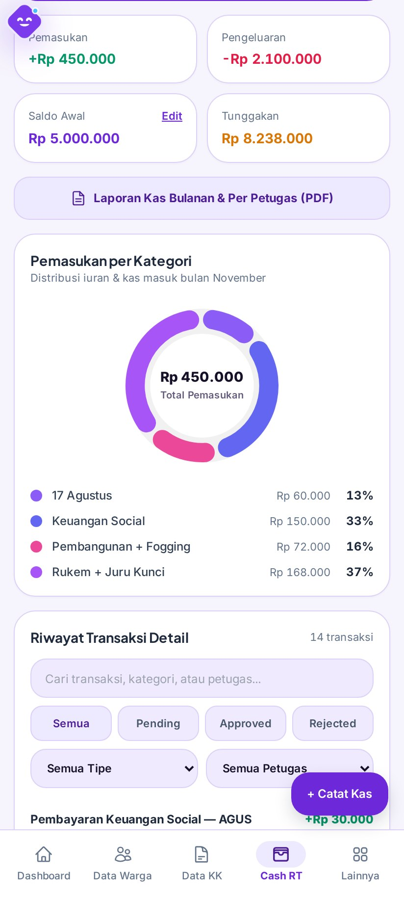
  
  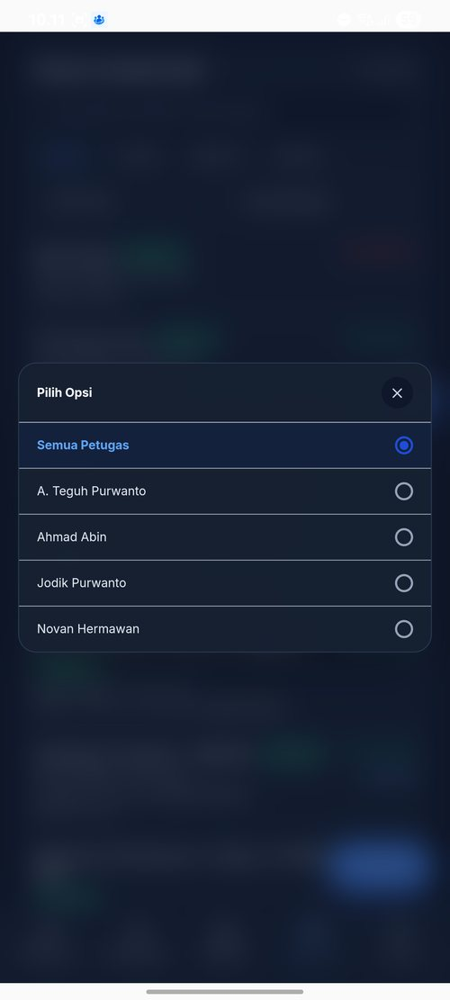
  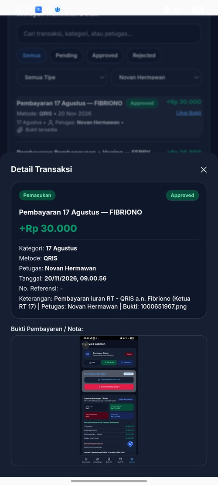
  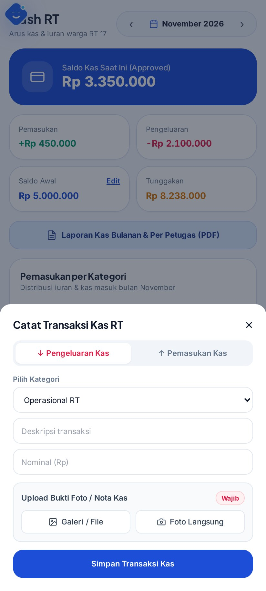
  
  

Tab **Cash RT** mengelola seluruh arus kas masuk dan keluar RT secara transparan, akurat, dan teraudit:

- **Kartu Saldo, KPI & Edit Saldo Awal:** Menampilkan **Saldo Kas Saat Ini (Approved)**, **Pemasukan**, **Pengeluaran**, **Saldo Awal** (dengan tombol *Edit* khusus Developer & Pak RT), dan **Tunggakan** periode berjalan.
- **Grafik Donat *Soft-Track* Seluruh Kategori Pemasukan:** Menampilkan proporsi **semua kategori pemasukan** berstatus *Approved*—baik 4 kategori iuran wajib maupun seluruh pemasukan tambahan dari `+ Catat Kas` (seperti *Sumbangan / Donasi Warga*, *Dana Sosial*, dll.)—dilengkapi *badge* `%` mengambang dan *tooltip* Flat UI di sisi luar irisan (`wkOuter`) agar tidak menimpa angka total di tengah.
- **Riwayat Transaksi Detail (Paginasi 10 Item) & Bukti Lintas Perangkat:** Menyediakan pencarian teks, filter status (**Semua, Pending, Approved, Rejected**), filter tipe (**Pemasukan, Pengeluaran**), filter **Petugas**, serta paginasi `Prev / Next` 10 transaksi per halaman. Mengetuk transaksi membuka pop-up **Detail Transaksi** dan pratinjau foto nota dari Supabase Storage.
- **Catat Kas (10 Kategori Pemasukan) & Alur *Pending Approval*:** Menyediakan 10 pilihan kategori pemasukan RT yang umum digunakan serta kategori pengeluaran. Pencatatan oleh Bendahara/Sekretaris otomatis berstatus **Pending Approval** hingga disetujui atau ditolak oleh Pak RT, Wakil RT, atau Developer melalui pop-up konfirmasi *frosted-blur*.

---

## 6. Tab Lainnya, Laporan & Pengaturan

  
  
  
  
  
  
  

Tab **Lainnya & Laporan** menghimpun pengaturan akun, pelaporan keuangan siap bagikan, manajemen data massal, dan pembaruan aplikasi:

- **Dropdown Bahasa Ringkas (`ID / EN / JV`) & Kartu Profil:** Di sudut kanan atas tersedia pemilih bahasa ringkas (**Indonesia**, **English**, **Basa Jawa**) dengan pop-up *frosted-blur*. Di bawahnya terdapat kartu profil pengguna dengan tombol **Foto**, **Edit Profil** (Nama, No. HP, Jabatan via `supabase.auth.updateUser`), **Ubah Password**, dan **Keluar**.
- **Laporan Keuangan 1 Bulan (Multi-PNG & PDF Lengkap):** Menyajikan ringkasan Saldo Awal, Pemasukan, Pengeluaran, Saldo Akhir, rincian seluruh kategori pemasukan (`allIncomeByCat`), pengeluaran, dan daftar lengkap KK belum lunas. Tombol **Share / Unduh PNG** otomatis membagi laporan panjang menjadi beberapa halaman tajam (16 KK/halaman) yang dibagikan sekaligus dalam **1× klik** (`saveAndShareMultipleBase64`), sedangkan **Share / Unduh PDF** menghasilkan dokumen A4 multi-halaman lengkap.
- **Rekap Kas Tahunan Fokus Bulan Aktif & Import/Export Excel:** Kartu **Rekap Kas Tahunan** langsung menyorot **Bulan Aktif** di posisi teratas tanpa scroll panjang (disertai lipatan `Lihat Semua 12 Bulan ▾`). Di bawahnya tersedia tombol **Template Excel**, **Export Global**, dan **Import Massal Warga (`.xlsx`/`.csv`)**.
- **Riwayat Aktivitas (Paginasi 10 Item), Tema Material You & Wajib Update APK:** Mencatat jejak audit aktivitas pengguna, menyediakan pengaturan tema (**Terang**, **Gelap**, **Device / Material You** API 31+), serta pengecekan rilis APK otomatis di GitHub Releases (termasuk background check setiap 2 jam via `UpdateCheckReceiver.kt`) dengan modal **Wajib Update** & notifikasi HP Android.

---

## 7. Panel Khusus Developer & Manajemen User

  
  
  
  
  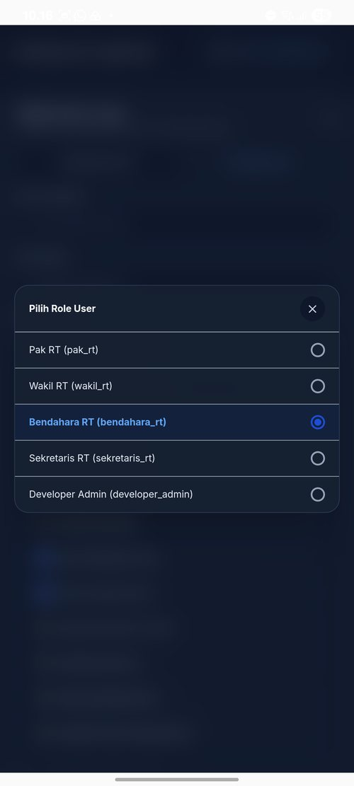
  

Khusus akun `developer@wargakita.id`, tersedia **Panel Khusus Developer** berdesain Flat UI biru solid (`SUPERUSER`) untuk administrasi sistem tingkat lanjut:

- **Kelola User Login (`005_developer_user_management.sql`):** Menampilkan seluruh daftar akun dari `auth.users` & `profiles` (`developer_list_users()`), menambah akun baru (`developer_create_user()`), mengedit nama/email/role/sandi (`developer_update_user()`), serta menghapus akun secara aman tanpa error *foreign key* (`developer_delete_user()` dengan konfirmasi *frosted-blur*).
- **10 Centang Hak Akses Granular (`custom_permissions`):** Saat menambah atau mengedit user, Developer dapat mengatur izin spesifik per akun (*Lihat Warga & KK, Tambah Warga, Edit Warga, Hapus Warga, Catat Bayar Iuran, Catat Kas RT, Approval Kas, Edit Saldo Awal, Kelola Agenda RT, Lihat NIK Penuh*). Mengganti **Role Database** otomatis mengisi centang bawaan role tersebut dan dapat disesuaikan bebas.
- **Ubah Password User & Reset Data Bulan Ini ke 0:** Akses cepat mengganti sandi sementara seluruh akun pengurus/bendahara maupun mereset data periode berjalan untuk pengujian.

---

## 8. Matriks Hak Akses & Arsitektur Sistem

| Role Database | Email Contoh | Lihat Warga | Tambah Warga | Edit / Hapus Warga | Catat Bayar & Kas | Approval Kas | Kalender & Saldo Awal | Baca & Rangkum File NawakAI | Aksi DB NawakAI | Panel Developer |
| :--- | :--- | :---: | :---: | :---: | :---: | :---: | :---: | :---: | :---: | :---: |
| **Developer Admin** | `developer@wargakita.id` | Ya | Ya | Ya | Ya (Auto-Approved) | Ya | Ya | Ya | Ya | Ya |
| **Pak RT** | `pakrt17@wargakita.id` | Ya | Ya | Ya | Ya (Auto-Approved) | Ya | Ya | Ya | Ya | Tidak |
| **Wakil RT** | `wakilrt17@wargakita.id` | Ya | Ya | Hapus saja | Tidak | Ya | Kalender saja | Ya | Ya | Tidak |
| **Bendahara RT** | `bendahara17@wargakita.id`, `novan@wargakita.id`, `ahmadabin@wargakita.id`, `teguh@wargakita.id`, `jodik@wargakita.id` | Ya | Tidak | Tidak | Ya (Pending Approval) | Tidak | Tidak | Ya | Tidak | Tidak |
| **Sekretaris RT** | `sekretaris17@wargakita.id` | Ya | Ya | Tidak | Tidak | Tidak | Tidak | Ya | Tidak | Tidak |

*(Catatan: Mulai `v1.15.3`, seluruh hak akses di atas dapat dikustomisasi per akun oleh **Developer Admin** melalui 10 centang `custom_permissions` di menu **Kelola User Login**).*

### Arsitektur Teknis
1. **Autentikasi & RLS:** Login melalui Supabase Auth (dilengkapi tombol mata intip sandi & wajib ganti sandi pada login awal) serta proteksi **Row Level Security (RLS)** di seluruh tabel PostgreSQL.
2. **Penyimpanan Bukti Terstruktur:** Foto bukti diunggah ke Supabase Storage bucket `receipts` dengan jalur `TAHUN/BULAN/PEMASUKKAN|PENGELUARAN/`.
3. **Asisten AI Hibrida:** Supabase Edge Function `nawak-ai` + *silent fallback* mesin lokal + OCR lokal (`Tesseract.js`, `PDF.js`, `Mammoth.js`, `SheetJS`) + 7 audio ElevenLabs MP3 *offline*.
4. **Build & Rilis APK Otomatis:** GitHub Actions (`.github/workflows/build-apk.yml`) membangun APK Android (`versionCode = 25`, `versionName = "1.15.3"`), menandatanganinya dengan *keystore* permanen dari GitHub Secrets, dan merilisnya ke **GitHub Releases**.

---

## Riwayat Perubahan
Lihat rincian lengkap pembaruan, peningkatan UI/UX, dan perbaikan bug per versi pada [CHANGELOG.md](CHANGELOG.md).

### Pembaruan Utama v1.15.3 (NawakAI Agent AI & Iuran Tahunan RT 17)
- **NawakAI Agent AI (24 Skill di 6 Domain):**
  - *Tampilan Baru Flat UI*: Popup mengambang ala Messenger dengan ikon wajik 6 ekspresi NawakAI, layar Beranda grid 2×2, *chatbox* kapsul ala Gemini, animasi *spring* Android 60fps, dan *Voice Command* (*Speech-to-Text* `id-ID` native Android & Web).
  - *Kecerdasan Agen*: Memori revisi *multi-turn*, audit klasifikasi & kebersihan data NIK/KK, catat pembayaran via chat/suara, simulasi proyeksi kas (*what-if*), generator surat pengantar RT 17 otomatis, pengingat tagihan WA santun, jadwal ronda, agenda kalender, log aduan warga, dan paket laporan rapat RT.
- **Klasifikasi Iuran Tahunan RT 17 (`Rp 138.000/thn`):**
  - **Point 1 (Wajib Penuh):** 4 kategori (*17 Agustus Rp 30rb, Keuangan Social Rp 30rb, Pembangunan + Fogging Rp 36rb, Rukem + Juru Kunci Rp 42rb*), termasuk kasus khusus `SRI ROKHANI`.
  - **Point 2 (Janda):** Hanya wajib *Rukem + Juru Kunci* (`Rp 42.000/thn`), otomatis menampilkan nama istri aktif jika kepala keluarga meninggal dunia.
  - **Point 3 (Kost) & Point 4 (Nonaktif):** Bebas tagihan, dengan deduplikasi tagihan tahunan (`1 tahun = 1 tagihan`) serta pelacakan tunggakan lintas tahun (`2025 & 2026`).

### Penyempurnaan v1.15.3 (Export Word `.docx`, Filter Status & Laporan PDF Serasi PNG)
- **Export Word `.docx` Valid:** Format ekspor Word kini menghasilkan dokumen `.docx` OOXML murni (bebas error *file rusak* di Android Word/Docs/WPS).
- **Filter Status Warga & Pemisahan Warga Kontrak:** Pilihan filter status (*Permanen, Kontrak, Kost, Janda, Pindah Domisili, Meninggal Dunia*) langsung di menu export NawakAI, dengan **Warga Kontrak** dipisahkan khusus di bagian paling bawah tabel di semua format (PNG, Excel, Word, PDF).
- **Footer PDF 7 Kartu KPI:** Tata letak ringkasan PDF disamakan dengan 7 kartu KPI berwarna + kotak kesimpulan milik export PNG.
- **Tampilan Agenda Ronda Rapi:** Daftar anggota ronda tampil terstruktur per baris (`whitespace-pre-line`) tanpa tombol Edit/Hapus yang keliru pada jadwal bawaan.
