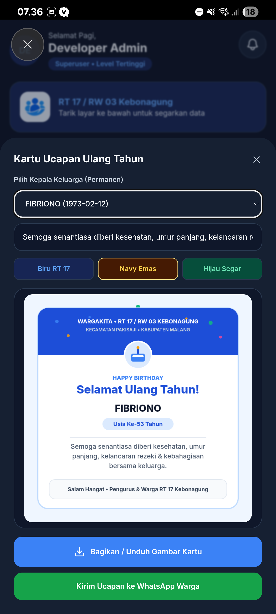
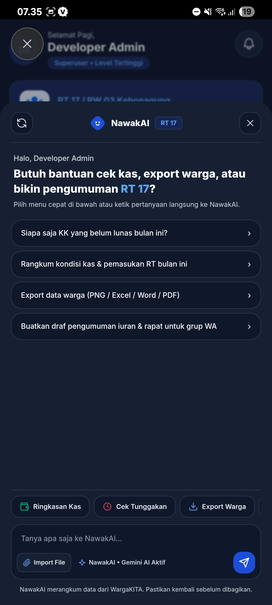
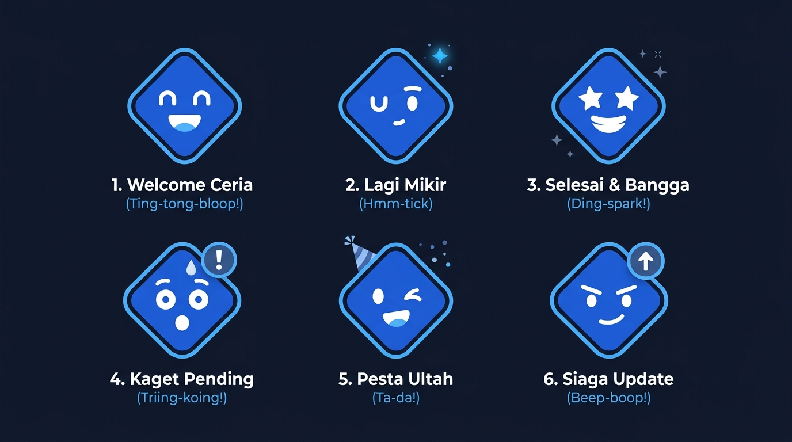
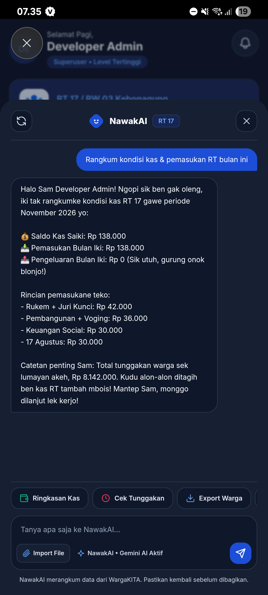
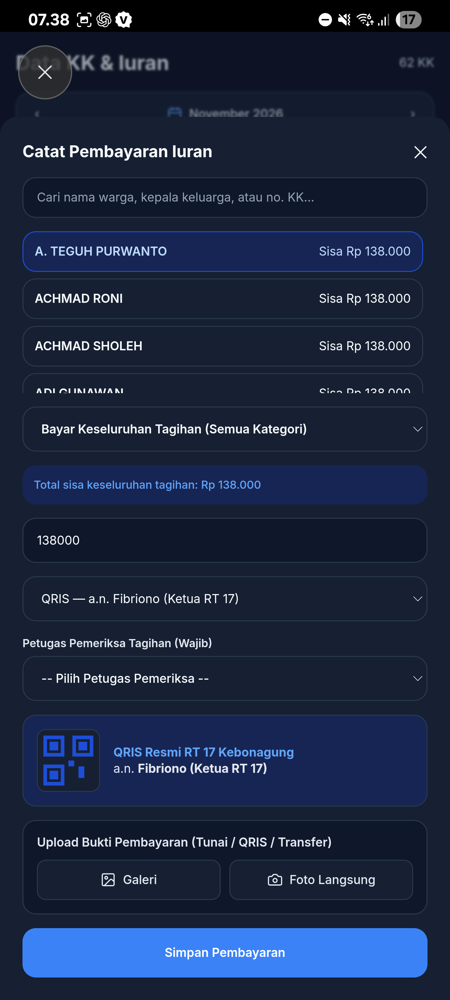
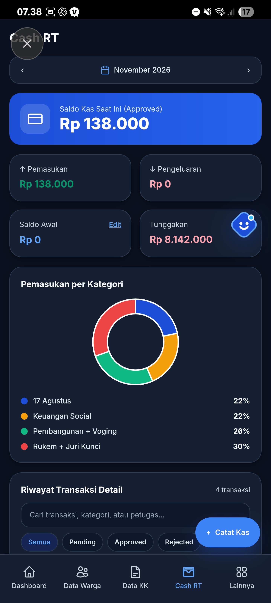
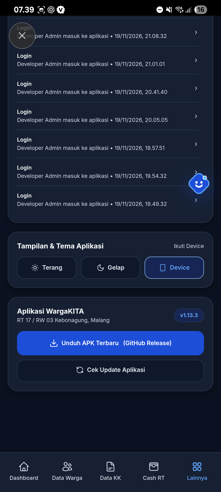

# WargaKITA — Aplikasi Administrasi & Keuangan RT 17 / RW 03 Kebonagung

**WargaKITA** (`v1.14.2`) adalah aplikasi Android & Web bergaya **Flat UI** untuk pengelolaan data kependudukan, iuran bulanan warga, kas RT, agenda kegiatan, asisten AI **NawakAI**, dan pelaporan keuangan **RT 17 / RW 03 Kebonagung, Malang**, terintegrasi secara *real-time* dengan **Supabase** (Auth, PostgreSQL + RLS, Storage, dan Edge Functions).

---

## Fitur & Fungsi Utama (v1.14.2)

### 1. Dashboard Utama, Ringkasan KPI & Grafik Pemasukan
Menampilkan sapaan sesuai waktu, identifikasi wilayah **RT 17 / RW 03 Kebonagung**, logo **WargaKITA** tersemat langsung (Base64) agar selalu tampil utuh, tombol notifikasi lonceng, serta **4 kartu KPI utama** (*Total KK*, *Total Warga*, *Saldo Kas RT*, dan *Total Tunggakan* bulan berjalan). Di bawahnya tersedia **Grafik Pemasukan 6 Bulan** untuk memantau tren setoran iuran dan kas RT secara visual, serta ikon melayang **NawakAI** (Wajik Biru) yang dapat digeser bebas (*draggable*) dan posisinya tersimpan otomatis.

---

### 2. Kalender Kegiatan Warga, Agenda Resmi RT & Pengingat HP Berkala
Menyajikan kalender interaktif bulanan yang membedakan **Agenda Resmi RT** (titik biru) dan **Ulang Tahun Kepala Keluarga Permanen** (titik oranye). Setiap agenda resmi dilengkapi tombol **Simpan ke HP** (sinkronisasi langsung ke Kalender Android `CalendarContract` dengan pengingat 60 & 15 menit sebelumnya), **Edit**, dan **Hapus**. Aplikasi juga mengirim notifikasi HP Android dan pengingat berkala di dalam aplikasi untuk **Agenda Resmi RT (H-3 hingga H-0)**, **Ulang Tahun Kepala Keluarga** (maksimal 1 kali per hari), serta pengingat **Pending Approval minimal 1 jam sekali** bagi **Pak RT**, **Wakil RT**, dan **Developer**. Pada bagian **Ulang Tahun Warga RT 17**, pengurus dapat langsung menekan tombol **Kartu** untuk membuat ucapan ulang tahun.

---

### 3. Kartu Ucapan Ulang Tahun Warga (Flat UI 3 Tema)
Modal khusus untuk membuat kartu ucapan ulang tahun bagi **Kepala Keluarga (Permanen)** lengkap dengan nama, usia otomatis, dan pesan ucapan yang dapat disesuaikan. Tersedia **3 pilihan tema Flat UI** (*Biru RT 17*, *Navy Emas*, dan *Hijau Segar*) dengan ilustrasi kue ulang tahun dan konfeti vektor, tombol **Bagikan / Unduh Gambar Kartu (PNG)**, serta tombol **Kirim Ucapan ke WhatsApp Warga** (`wa.me`) satu ketuk.

---

### 4. NawakAI — Tampilan Chat Bergaya Gemini & Sapaan Sinkron WIB Malang
Membuka ikon Wajik Biru akan menampilkan **NawakAI** dengan antarmuka **bergaya Gemini** yang adaptif terhadap Tema Terang maupun Gelap (OLED `#000000`, *bubble* user `#28292c`, kotak input `#1e1f20`), ikon resmi **Wajik NawakAI + teks `NawakAI RT 17`** tepat di tengah header dengan warna menyesuaikan tema, serta pengaman *anti ghost-click* `320ms`.
- **Sapaan Awal Sinkron Zona Waktu WIB (`Asia/Jakarta`) Malang:** Saat pertama kali masuk aplikasi, NawakAI **wajib** mengucapkan salam sesuai waktu lokal Malang yang sinkron persis antara teks *bubble* dan suara MP3-nya (**04.00–10.59 WIB** *Sugeng enjang*, **11.00–16.59 WIB** *Sugeng siang*, **17.00–03.59 WIB** *Sugeng dalu*), sedangkan pengingat agenda/ulang tahun berjalan secara berkala tanpa mengganggu saat baru masuk aplikasi.
- **Gelembung Kontekstual Mengikuti Posisi:** Saat pengguna berpindah ke tab **Data Warga**, **Data KK**, atau **Cash RT**, NawakAI menampilkan *speech bubble* tips kontekstual dengan jeda berkala (minimal 2 jam antar popup & 6 jam per tab), di mana hanya tab **Data Warga** yang bersuara maksimal **1×24 jam** sementara tab **Data KK** dan **Cash RT** tampil tenang tanpa suara.

---

### 5. NawakAI — 6 Ekspresi Lucu & 7 Audio Suara ElevenLabs Tertanam
Maskot **Wajik Biru NawakAI** dilengkapi **6 ekspresi wajah dinamis**, **efek suara sintesis ringan (*Web Audio Synth*)**, serta **7 rekaman suara ElevenLabs MP3 berbahasa Jawa-Malangan** yang tertanam langsung secara *offline* di dalam aplikasi (`welcome_pagi`, `welcome_siang`, `welcome_malam`, `pending`, `party`, `tips`, `update`):
- **Welcome Ceria:** Mata melengkung senang & senyum lebar saat menyapa Pagi, Siang, atau Malam sesuai jam WIB Malang.
- **Lagi Mikir:** Animasi wajah (mata & senyum putih saja) saat memproses pertanyaan di dalam chat.
- **Selesai & Bangga:** Mata bintang & senyum lebar saat jawaban selesai disusun.
- **Kaget Pending Approval:** Mata melotot kaget, tetes keringat, & lencana **`!`** saat pengingat transaksi menunggu persetujuan muncul.
- **Pesta Ultah & Agenda:** Mata kedip (*wink*), topi pesta mini, & konfeti saat pengingat berkala ulang tahun Kepala Keluarga atau agenda RT terdekat muncul.
- **Siaga Update:** Alis fokus & lencana panah ke atas (`↑`) saat versi APK terbaru tersedia di GitHub Releases.

---

### 6. NawakAI — Timeline Gemini, Input Multi-Baris & Lampiran Semua Jenis File
Didukung oleh **Gemini AI** melalui Supabase Edge Function `nawak-ai` dengan *silent fallback* mulus ke mesin lokal + **OCR Resolusi Tinggi (*Tesseract.js + PDF.js*)** + **Mammoth.js** (`.docx`) + **SheetJS** (`.xlsx`/`.xls`/`.csv`/`.ods`):
- **Timeline Bertahap & Bubble Panjang Minimalis:** Menampilkan loader wajah (mata + senyum), garis vertikal `1px` dengan kontras teks langkah selesai (redup) vs langkah aktif (terang) hingga ikon centang **`Selesai`** yang sejajar presisi. Pesan user panjang (>4 baris) otomatis diringkas dengan tombol buka/tutup (`▾/▴`).
- **Input Multi-Baris & Preview Lampiran di Dalam Kapsul:** Kotak ketik `<textarea>` transparan dengan *placeholder* berbahasa Jawa (`Takok opo wae nang NawakAI...`), tombol kirim khusus (`Enter` membuat baris baru tanpa langsung terkirim), serta tombol **`+`** ala Gemini dengan pratinjau gambar/dokumen + tombol `✕` di bagian dalam atas kotak input.
- **Dukungan Semua Jenis File & Input Database Otomatis:** Tombol `+` terbuka untuk semua pengguna dan mendukung **PNG, JPG, WEBP, PDF (hingga 10 halaman + OCR), Excel/CSV/ODS (seluruh sheet), Word (`.docx`/`.doc`), serta TXT/MD/JSON/XML/LOG**. NawakAI membaca isi file, menyajikan data terstruktur, merangkum & menyimpulkannya secara detail, serta memunculkan tombol konfirmasi **`Jalankan Import Sekarang`** (anti-duplikat) jika file mengandung data warga/KK dan akun memiliki hak akses pengurus.
- **Export Data Warga 4 Format Lengkap:** Mengekspor seluruh data warga 7 kolom lengkap ke **PNG**, **Excel (`.xlsx`)**, **Word (`.doc`)**, dan **PDF**.

---

### 7. Data Warga — Direktori Lengkap & Pencarian Cepat
Menampilkan seluruh daftar warga RT 17 dengan kolom pencarian real-time berdasarkan **nama, NIK, nomor KK, alamat, atau nomor HP**, serta filter berdasarkan **Agama**. Setiap kartu warga menampilkan inisial, nama lengkap, status tinggal, nomor KK, hubungan keluarga, serta alamat terbaru yang tersinkronisasi penuh dengan data KK saat diedit.

---

### 8. Data Warga — Filter Status Tinggal Berwarna Kontras
Mempermudah pemetaan status kependudukan melalui tab filter dengan warna aktif yang kontras di mode terang maupun gelap: **Semua** (biru), **Permanen** (hijau), **Kontrak** (oranye/amber), **Kost** (biru muda), dan **Pindah Domisili** (merah). Warga berstatus **Pindah Domisili** otomatis dikecualikan dari tagihan bulanan (**Tanpa Tagihan**).

---

### 9. Tambah Data Warga Baru (1 KK) & Warga Lama (KK Ada)
Formulir input kependudukan yang dipisah antara **Warga Baru (1 KK)** untuk mendaftarkan satu keluarga penuh sekaligus banyak anggota dalam satu kali simpan, dan **Warga Lama (KK Ada)** untuk menambah anggota ke KK yang sudah terdaftar. Mendukung pilihan hubungan keluarga lengkap (`Kepala Keluarga`, `Suami`, `Istri`, `Pasangan`, `Anak`, `Orang Tua`, `Mertua`, `Menantu`, `Cucu`, `Famili Lain`, `Lainnya`) serta tampilan responsif agar kolom ketik tidak tertutupi keyboard Android.

---

### 10. Data KK & Status Pembayaran Iuran Bulanan
Daftar seluruh **Kepala Keluarga** diurutkan secara alfabetis (A–Z) lengkap dengan indikator warna status iuran bulan berjalan: **Semua**, **Hijau** (Lunas), **Kuning** (Sebagian), **Merah** (Belum Bayar), dan **Tanpa Tagihan**. Mengetuk kartu KK akan membuka **Detail KK** beserta daftar anggota keluarga, alamat tersinkronisasi, dan tombol **Telepon** (`tel:`) serta **WhatsApp** (`wa.me`) langsung ke nomor Kepala Keluarga.

---

### 11. Catat Pembayaran Iuran, 4 Petugas Bendahara Khusus & QRIS
Formulir pencatatan iuran bulanan per KK yang mendukung opsi **Bayar Keseluruhan Tagihan (Semua Kategori)** atau per kategori individual, metode **QRIS (a.n. Fibriono — Ketua RT 17)** / **Transfer Bank** / **Tunai**, serta unggah foto bukti pembayaran dari **Galeri** atau **Foto Langsung** kamera ke Supabase Storage. Khusus 4 akun **Bendahara RT**, kategori dan nama petugas otomatis terisi serta terkunci sesuai tugas masing-masing:
- **Novan Hermawan** (`novan@wargakita.id`) → **17 Agustus**
- **Ahmad Abin** (`ahmadabin@wargakita.id`) → **Keuangan Social**
- **A. Teguh Purwanto** (`teguh@wargakita.id`) → **Pembangunan + Voging**
- **Jodik Purwanto** (`jodik@wargakita.id`) → **Rukem + Juri Kunci**

---

### 12. Cash RT — Ringkasan Saldo, Saldo Awal & Grafik Kategori
Menampilkan posisi **Saldo Kas Saat Ini**, rincian total **Pemasukan** dan **Pengeluaran** bulan berjalan, tombol **Edit Saldo Awal** (khusus Developer & Pak RT), serta **Grafik Donat Soft-Track dengan Badge Persentase Mengambang** yang menampilkan **seluruh kategori pemasukan** (4 kategori iuran wajib maupun seluruh kategori tambahan seperti *Sumbangan / Donasi Warga*) sehingga total grafik selalu sinkron penuh dengan kartu **Pemasukan** dan **Laporan Keuangan 1 Bulan**.

---

### 13. Cash RT — Riwayat Transaksi Detail, Paginasi & Filter Persetujuan
Menyajikan daftar lengkap seluruh transaksi kas RT dengan paginasi **10 item per halaman** (`Prev / Next`), pencarian teks (transaksi, kategori, petugas, metode), filter status (**Semua**, **Pending**, **Approved**, **Rejected**), filter tipe (**Pemasukan**, **Pengeluaran**), dan filter **Nama Petugas**. Setiap kartu menampilkan lencana status persetujuan, nama petugas pemeriksa, indikator **Bukti tersedia**, tombol **Lihat Bukti** lintas perangkat, serta pop-up **Detail Transaksi** saat diketuk.

---

### 14. Catat Transaksi Kas RT & Unggah Bukti Nota
Modal pencatatan pemasukan atau pengeluaran kas umum RT (di luar iuran KK) dengan pilihan tipe **Pengeluaran** atau **Pemasukan**, pemilihan kategori, nominal, keterangan, petugas pemeriksa (otomatis terisi & terkunci untuk akun Bendahara khusus), serta unggah foto nota/bukti transaksi ke Supabase Storage (`receipts`). Transaksi yang dicatat oleh **Bendahara RT** atau **Sekretaris RT** otomatis berstatus **Pending Approval** hingga disetujui oleh **Pak RT**, **Wakil RT**, atau **Developer Admin**.

---

### 15. Tab Lainnya — Kartu Edit Profil, Panel Developer & Laporan Keuangan 1 Bulan
Menampilkan kartu profil akun pengguna yang sedang login lengkap dengan tombol **Foto**, **Edit Profil** (ubah Nama Tampilan, No. HP/WhatsApp, dan Jabatan yang tersinkronisasi melalui Supabase Auth), **Password**, dan **Keluar**. Khusus akun `developer@wargakita.id`, tersedia **Panel Khusus Developer** berisi **Ubah Password User Lain** (mencakup semua role termasuk 4 akun Bendahara khusus) dan **Reset Data Bulan Ini ke 0**. Di bawahnya terdapat ringkasan **Laporan Keuangan 1 Bulan** yang siap dibagikan.

---

### 16. Rekap Kas Tahunan, Import/Export Database Warga & Riwayat Aktivitas
Berisi tombol ekspor laporan **Share / Unduh PNG** dan **Share / Unduh PDF**, **Export Database Warga Global**, kartu **Rekap Kas Tahunan** (akumulasi pemasukan, pengeluaran, dan selisih bersih 12 bulan Januari–Desember), menu **Import & Export Database Warga** (unduh Template Excel `.xlsx` & import massal), serta daftar **Riwayat Aktivitas Akun Anda** dengan paginasi 10 item yang dapat diketuk untuk melihat detail aktivitas.

---

### 17. Pengaturan Tema (Terang/Gelap/Device), Bahasa & Wajib Update APK Otomatis
Menyediakan pengaturan **Tampilan & Tema Aplikasi** (**Terang**, **Gelap**, atau **Device** yang mengikuti warna sistem **Material You** Android secara *real-time* dengan palet Flat UI kontras tinggi) serta pilihan **3 Bahasa** (**Indonesia**, **English**, **Basa Jawa**). Pada bagian paling bawah ditampilkan informasi versi aplikasi terpasang (`v1.14.2`), tombol **Unduh APK Terbaru (GitHub Release)**, dan tombol **Cek Update Aplikasi**. Saat rilis baru tersedia di GitHub Releases (termasuk pengecekan otomatis di latar belakang setiap 2 jam via `UpdateCheckReceiver.kt`), aplikasi langsung mengirimkan **notifikasi HP Android** dan menampilkan pop-up **Wajib Update** lengkap dengan rincian *changelog* terbaru (APK rilis ditandatangani dengan *keystore* permanen sehingga pembaruan langsung menimpa versi lama tanpa *uninstall*).

---

## Matriks Hak Akses

| Role | Email Login | Lihat Warga | Tambah Warga | Edit / Hapus Warga | Catat Bayar & Kas | Approval Transaksi | Kalender & Saldo Awal | Baca & Rangkum File NawakAI | Import / Aksi DB NawakAI | Panel Developer |
| :--- | :--- | :---: | :---: | :---: | :---: | :---: | :---: | :---: | :---: | :---: |
| **Developer Admin** | `developer@wargakita.id` | Ya | Ya | Ya | Ya (Auto-Approved) | Ya | Ya | Ya | Ya | Ya |
| **Pak RT** | `pakrt17@wargakita.id` | Ya | Ya | Ya | Ya (Auto-Approved) | Ya | Ya | Ya | Ya | Tidak |
| **Wakil RT** | `wakilrt17@wargakita.id` | Ya | Ya | Hapus saja | Tidak | Ya | Kalender saja | Ya | Ya | Tidak |
| **Bendahara Umum / Khusus** | `bendahara17@wargakita.id`, `novan@wargakita.id`, `ahmadabin@wargakita.id`, `teguh@wargakita.id`, `jodik@wargakita.id` | Ya | Tidak | Tidak | Ya (Pending Approval) | Tidak | Tidak | Ya | Tidak | Tidak |
| **Sekretaris RT** | `sekretaris17@wargakita.id` | Ya | Ya | Tidak | Tidak | Tidak | Tidak | Ya | Tidak | Tidak |

---

## Cara Kerja & Arsitektur Sistem

1. **Autentikasi & Keamanan:** Login via Supabase Auth (layar login dilengkapi ikon **mata dicoret** untuk melihat/menyembunyikan password), wajib ganti password pada login pertama, dan seluruh tabel dilindungi **Row Level Security (RLS)**.
2. **Alur Persetujuan (*Pending Approval*):** Setiap pencatatan pemasukan maupun pengeluaran oleh **Bendahara RT** atau **Sekretaris RT** otomatis berstatus **Pending Approval** hingga disetujui oleh **Pak RT**, **Wakil RT**, atau **Developer** (dilengkapi pengingat notifikasi HP minimal 1 jam sekali).
3. **Penyimpanan Bukti di Supabase Storage:** Foto bukti diunggah ke bucket `receipts` dengan struktur `TAHUN/BULAN/PEMASUKKAN|PENGELUARAN/` dan format nama terstandar (`Pemasukkan_Tanggal_NamaWarga` / `Lainnya_Nominal_NamaPemasukkan` / `Pengeluaran_Nominal_NamaPengeluaran`).
4. **Asisten AI Hibrida & Suara ElevenLabs (`nawak-ai` + OCR/Word/Excel Lokal):** Permintaan chat dan lampiran dikirim ke Supabase Edge Function `nawak-ai` (atau diekstrak secara lokal via `PDF.js`, `Tesseract.js`, `Mammoth.js`, dan `SheetJS`), dengan *silent fallback* berbahasa Jawa-Malangan serta 7 rekaman suara ElevenLabs MP3 yang tertanam langsung secara *offline*.
5. **Build & Rilis APK Otomatis:** GitHub Actions (`.github/workflows/build-apk.yml`) membangun APK rilis Android (`versionCode = 19`, `versionName = "1.14.2"`), menandatanganinya menggunakan *keystore* permanen dari GitHub Secrets, dan mempublikasikannya ke **GitHub Releases**.

---

## Riwayat Perubahan (Changelog)
Lihat catatan lengkap dan mendetail untuk setiap versi pada file [CHANGELOG.md](CHANGELOG.md).
