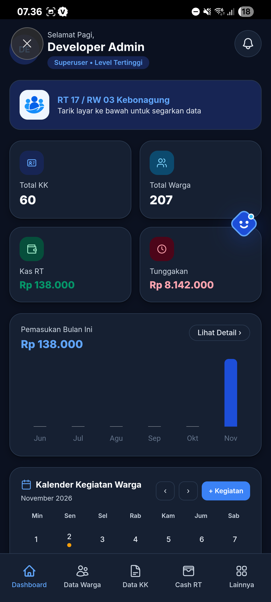
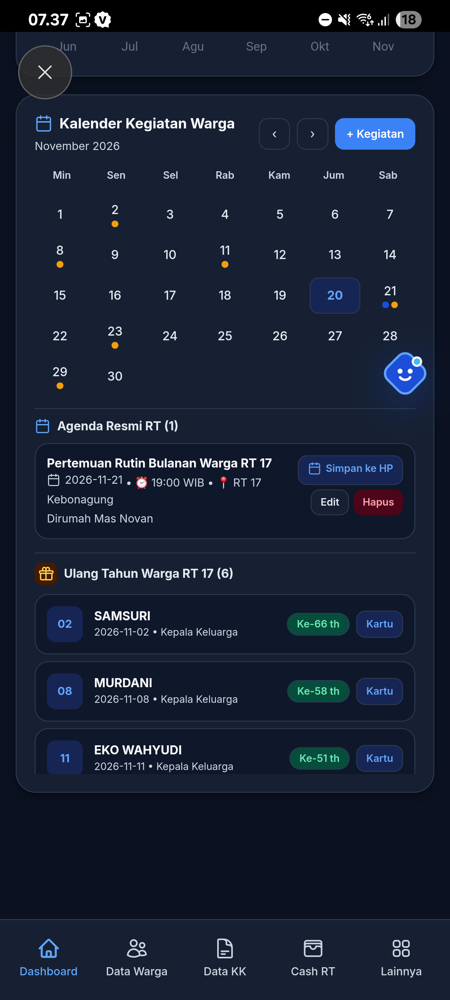
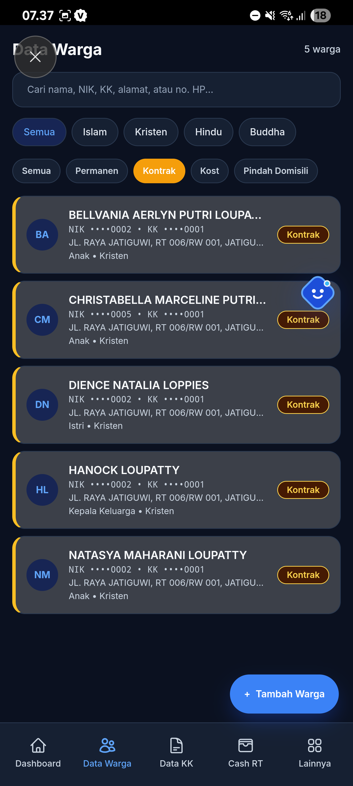
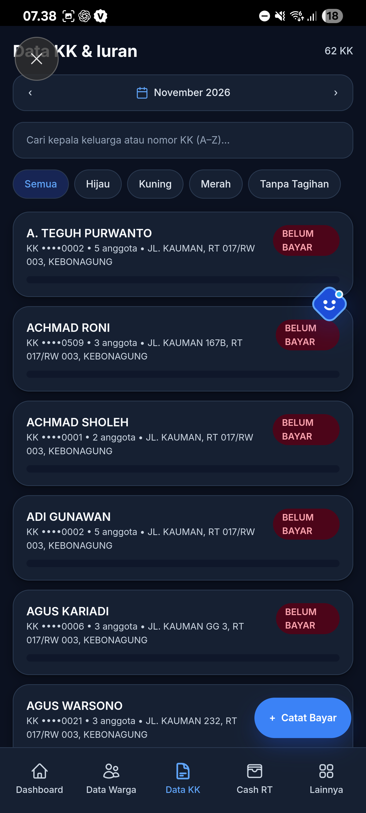
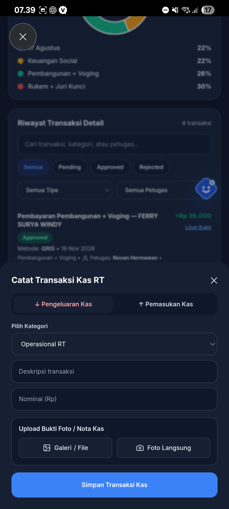

# WargaKITA — Aplikasi Administrasi & Keuangan RT 17 / RW 03 Kebonagung

**WargaKITA** (`v1.14.0`) adalah aplikasi Android & Web bergaya **Flat UI** untuk pengelolaan data kependudukan, iuran bulanan warga, kas RT, agenda kegiatan, asisten AI **NawakAI**, dan pelaporan keuangan **RT 17 / RW 03 Kebonagung, Malang**, terintegrasi secara *real-time* dengan **Supabase** (Auth, PostgreSQL + RLS, Storage, dan Edge Functions).

---

## Fitur & Fungsi Utama (v1.14.0)

### 1. Dashboard Utama, Ringkasan KPI & Grafik Pemasukan
Menampilkan sapaan sesuai waktu, identifikasi wilayah **RT 17 / RW 03 Kebonagung**, tombol notifikasi lonceng, serta **4 kartu KPI utama** (*Total KK*, *Total Warga*, *Saldo Kas RT*, dan *Total Tunggakan* bulan berjalan). Di bawahnya tersedia **Grafik Pemasukan 6 Bulan** untuk memantau tren setoran iuran dan kas RT secara visual, serta ikon melayang **NawakAI** (Wajik Biru) yang dapat digeser (*draggable*) dan posisinya tersimpan otomatis.

---

### 2. Kalender Kegiatan Warga, Agenda Resmi RT & Ulang Tahun Warga
Menyajikan kalender interaktif bulanan yang membedakan **Agenda Resmi RT** (titik biru) dan **Ulang Tahun Kepala Keluarga Permanen** (titik oranye). Setiap agenda resmi dilengkapi tombol **Simpan ke HP** (sinkronisasi langsung ke Kalender Android `CalendarContract` dengan pengingat 60 & 15 menit sebelumnya), **Edit**, dan **Hapus**, serta notifikasi pengingat otomatis di HP Android mulai **H-3 hingga H-0** acara. Pada bagian **Ulang Tahun Warga RT 17**, pengurus dapat langsung menekan tombol **Kartu** untuk membuat ucapan ulang tahun.

---

### 3. Kartu Ucapan Ulang Tahun Warga (Flat UI 3 Tema)
Modal khusus untuk membuat kartu ucapan ulang tahun bagi **Kepala Keluarga (Permanen)** lengkap dengan nama, usia otomatis, dan pesan ucapan yang dapat disesuaikan. Tersedia **3 pilihan tema Flat UI** (*Biru RT 17*, *Navy Emas*, dan *Hijau Segar*) dengan ilustrasi kue ulang tahun dan konfeti vektor, tombol **Bagikan / Unduh Gambar Kartu (PNG)**, serta tombol **Kirim Ucapan ke WhatsApp Warga** (`wa.me`) satu ketuk.

---

### 4. NawakAI — Beranda Asisten Pintar RT 17
Membuka ikon Wajik Biru akan menampilkan **Beranda NawakAI** terlebih dahulu (dilengkapi pengaman *anti ghost-click* `320ms` agar pertanyaan tidak terklik otomatis saat dibuka). Di beranda tersedia kartu pertanyaan cepat, *quick chips* (**Ringkasan Kas**, **Cek Tunggakan**, **Export Warga**), tombol **Import File** (khusus role **Developer Admin** dan **Pak RT**), serta indikator status **NawakAI • Gemini AI Aktif**. Di luar jendela chat, NawakAI juga menampilkan *welcome bubble* kontekstual sesuai waktu (*Pagi*, *Siang*, *Sore*, *Malam*) dan kondisi RT terkini (approval tertunda, agenda H-3, atau ulang tahun warga hari ini).

---

### 5. NawakAI — Chat Gemini AI Berbahasa Jawa-Malangan, Import & Export 4 Format
Didukung oleh **Gemini AI** melalui Supabase Edge Function `nawak-ai` dengan *silent fallback* mulus ke mesin lokal yang diperkaya tanpa menampilkan pesan error teknis ke pengguna. NawakAI menjawab dengan gaya bahasa **Jawa-Malangan yang lucu, unik, ringkas, dan cepat dibaca**, dalam gelembung chat **Flat UI** yang proporsional. Fitur utamanya meliputi:
- **Tanya Data RT Secara Langsung:** Ringkasan kas, cek tunggakan KK, cari data warga, cek petugas penagih, rincian pengeluaran, rekap kas 12 bulan, draf pengumuman WhatsApp, hingga membuka Kartu Ucapan Ulang Tahun.
- **Import Data Warga (`.xlsx`, `.xls`, `.csv`):** Khusus **Developer Admin** dan **Pak RT** untuk mengimpor data warga langsung dari dalam chat NawakAI.
- **Export Data Warga 4 Format:** Mengekspor data warga secara rapi ke format pilihan pengguna (**PNG**, **Excel `.xlsx`**, **Word `.doc`**, dan **PDF**).

---

### 6. Data Warga — Direktori Lengkap & Pencarian Cepat
Menampilkan seluruh daftar warga RT 17 (dalam contoh menampilkan `209 warga`) dengan kolom pencarian real-time berdasarkan **nama, NIK, nomor KK, alamat, atau nomor HP**, serta filter berdasarkan **Agama**. Setiap kartu warga menampilkan inisial, nama lengkap, status tinggal, nomor KK, dan hubungan keluarga.

---

### 7. Data Warga — Filter Status Tinggal Berwarna Kontras
Mempermudah pemetaan status kependudukan melalui tab filter dengan warna aktif yang kontras di mode terang maupun gelap: **Semua** (biru), **Permanen** (hijau), **Kontrak** (oranye/amber), **Kost** (biru muda), dan **Pindah Domisili** (merah). Warga berstatus **Pindah Domisili** otomatis dikecualikan dari tagihan bulanan (**Tanpa Tagihan**).

---

### 8. Tambah Data Warga Baru (1 KK) & Warga Lama (KK Ada)
Formulir input kependudukan yang dipisah antara **Warga Baru (1 KK)** untuk mendaftarkan satu keluarga penuh sekaligus banyak anggota dalam satu kali simpan, dan **Warga Lama (KK Ada)** untuk menambah anggota ke KK yang sudah terdaftar. Mendukung pilihan hubungan keluarga lengkap (`Kepala Keluarga`, `Suami`, `Istri`, `Pasangan`, `Anak`, `Orang Tua`, `Mertua`, `Menantu`, `Cucu`, `Famili Lain`, `Lainnya`).

---

### 9. Data KK & Status Pembayaran Iuran Bulanan
Daftar seluruh **Kepala Keluarga** diurutkan secara alfabetis (A–Z) lengkap dengan indikator warna status iuran bulan berjalan: **Semua**, **Hijau** (Lunas), **Kuning** (Sebagian), **Merah** (Belum Bayar), dan **Tanpa Tagihan**. Mengetuk kartu KK akan membuka **Detail KK** beserta daftar anggota keluarga dan tombol **Telepon** (`tel:`) serta **WhatsApp** (`wa.me`) langsung ke nomor Kepala Keluarga.

---

### 10. Catat Pembayaran Iuran, Petugas Pemeriksa & QRIS
Formulir pencatatan iuran bulanan per KK yang mendukung opsi **Bayar Keseluruhan Tagihan (Semua Kategori)** atau per kategori individual. Dilengkapi pilihan wajib **Petugas Pemeriksa Tagihan (A–Z)** (`A. Teguh Purwanto`, `Ahmad Abin`, `Jodik Purwanto`, `Novan Hermawan`), metode pembayaran **QRIS (a.n. Fibriono — Ketua RT 17)** / **Transfer Bank** / **Tunai**, serta unggah foto bukti pembayaran dari **Galeri** atau **Foto Langsung** kamera ke Supabase Storage.

---

### 11. Cash RT — Ringkasan Saldo, Saldo Awal & Grafik Kategori
Menampilkan posisi **Saldo Kas Saat Ini**, rincian total **Pemasukan** dan **Pengeluaran** bulan berjalan, tombol **Edit Saldo Awal** (khusus Developer & Pak RT), serta **Grafik Donat** proporsi pemasukan atau pengeluaran per kategori secara interaktif.

---

### 12. Cash RT — Riwayat Transaksi Detail & Filter Persetujuan
Menyajikan daftar lengkap seluruh transaksi kas RT dengan pencarian teks (transaksi, kategori, petugas, metode), filter status (**Semua**, **Pending**, **Approved**, **Rejected**), filter tipe (**Pemasukan**, **Pengeluaran**), dan filter **Nama Petugas**. Setiap kartu menampilkan lencana status persetujuan, nama petugas pemeriksa, indikator **Bukti tersedia**, tombol **Lihat Bukti** lintas perangkat, serta pop-up **Detail Transaksi** saat diketuk.

---

### 13. Catat Transaksi Kas RT & Unggah Bukti Nota
Modal pencatatan pemasukan atau pengeluaran kas umum RT (di luar iuran KK) dengan pilihan tipe **Pengeluaran** atau **Pemasukan**, pemilihan kategori, nominal, keterangan, petugas pemeriksa, serta unggah foto nota/bukti transaksi ke Supabase Storage (`receipts`). Transaksi yang dicatat oleh **Bendahara RT** atau **Sekretaris RT** otomatis berstatus **Pending Approval** hingga disetujui oleh **Pak RT**, **Wakil RT**, atau **Developer Admin**.

---

### 14. Tab Lainnya — Profil, Panel Developer & Laporan Keuangan 1 Bulan
Menampilkan kartu profil akun pengguna yang sedang login beserta tombol **Foto Profil**, **Ganti Password**, dan **Keluar**. Khusus akun `developer@wargakita.id`, tersedia **Panel Khusus Developer** untuk pengelolaan sistem tingkat lanjut. Di bawahnya terdapat ringkasan **Laporan Keuangan 1 Bulan** yang siap dibagikan atau dicetak.

---

### 15. Rekap Kas Tahunan, Import/Export Database Warga & Riwayat Aktivitas
Berisi tombol ekspor laporan **Share / Unduh PNG** dan **Share / Unduh PDF**, **Export Database Warga Global**, kartu **Rekap Kas Tahunan** (akumulasi pemasukan, pengeluaran, dan selisih bersih 12 bulan Januari–Desember), menu **Import & Export Database Warga** (unduh Template Excel `.xlsx` & import massal), serta daftar **Riwayat Aktivitas Akun Anda** yang dapat diketuk untuk melihat detail aktivitas.

---

### 16. Pengaturan Tema (Terang/Gelap/Device) & Cek Update APK Otomatis
Menyediakan pengaturan **Tampilan & Tema Aplikasi** (**Terang**, **Gelap**, atau **Device** yang mengikuti tema sistem Android secara *real-time* dengan palet Flat UI kontras tinggi). Pada bagian paling bawah ditampilkan informasi versi aplikasi terpasang (`v1.14.0`), tombol **Unduh APK Terbaru (GitHub Release)**, dan tombol **Cek Update Aplikasi** yang memeriksa rilis terbaru secara otomatis (APK rilis ditandatangani dengan *keystore* permanen sehingga pembaruan langsung menimpa versi lama tanpa *uninstall*).

---

## Matriks Hak Akses (5 Role)

| Role | Email Login | Lihat Warga | Tambah Warga | Edit / Hapus Warga | Catat Bayar & Kas | Approval Transaksi | Kalender & Saldo Awal | Import NawakAI | Panel Developer |
| :--- | :--- | :---: | :---: | :---: | :---: | :---: | :---: | :---: | :---: |
| **Developer Admin** | `developer@wargakita.id` | Ya | Ya | Ya | Ya (Auto-Approved) | Ya | Ya | Ya | Ya |
| **Pak RT** | `pakrt17@wargakita.id` | Ya | Ya | Ya | Ya (Auto-Approved) | Ya | Ya | Ya | Tidak |
| **Wakil RT** | `wakilrt17@wargakita.id` | Ya | Ya | Hapus saja | Tidak | Ya | Kalender saja | Tidak | Tidak |
| **Bendahara RT** | `bendahara17@wargakita.id` | Ya | Tidak | Tidak | Ya (Pending Approval) | Tidak | Tidak | Tidak | Tidak |
| **Sekretaris RT** | `sekretaris17@wargakita.id` | Ya | Ya | Tidak | Tidak | Tidak | Tidak | Tidak | Tidak |

---

## Cara Kerja & Arsitektur Sistem

1. **Autentikasi & Keamanan:** Login via Supabase Auth (layar login dilengkapi ikon mata bercentang untuk melihat password), wajib ganti password pada login pertama, dan seluruh tabel dilindungi **Row Level Security (RLS)**.
2. **Alur Persetujuan (*Pending Approval*):** Setiap pencatatan pemasukan maupun pengeluaran oleh **Bendahara RT** atau **Sekretaris RT** wajib memilih **Nama Petugas** dan otomatis berstatus **Pending Approval** hingga disetujui oleh **Pak RT**, **Wakil RT**, atau **Developer**.
3. **Penyimpanan Bukti di Supabase Storage:** Foto bukti diunggah ke bucket `receipts` dengan struktur `TAHUN/BULAN/PEMASUKKAN|PENGELUARAN/` dan format nama terstandar (`Pemasukkan_Tanggal_NamaWarga` / `Lainnya_Nominal_NamaPemasukkan` / `Pengeluaran_Nominal_NamaPengeluaran`).
4. **Asisten AI Hibrida (`nawak-ai`):** Permintaan chat dikirim ke Supabase Edge Function `nawak-ai` (memanggil Gemini API dengan `thinkingBudget: 0`). Jika API eksternal sedang sibuk atau tidak terjangkau, aplikasi otomatis beralih ke mesin lokal berbahasa Jawa-Malangan tanpa menampilkan pesan error teknis.
5. **Build & Rilis APK Otomatis:** GitHub Actions (`.github/workflows/build-apk.yml`) mengekstrak `WargaKITA_GitHub_Backup.zip`, menandatangani APK rilis menggunakan *keystore* permanen dari GitHub Secrets, dan mempublikasikannya ke **GitHub Releases**.

---

## Riwayat Perubahan (Changelog)
Lihat catatan lengkap dan mendetail untuk setiap versi pada file [CHANGELOG.md](CHANGELOG.md).
