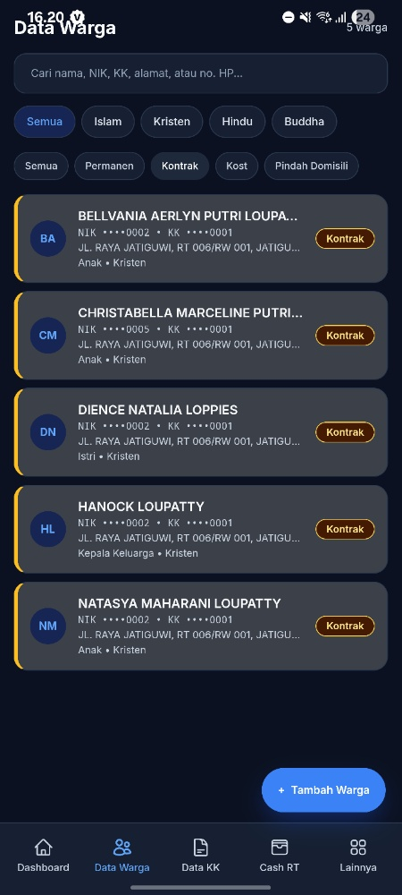
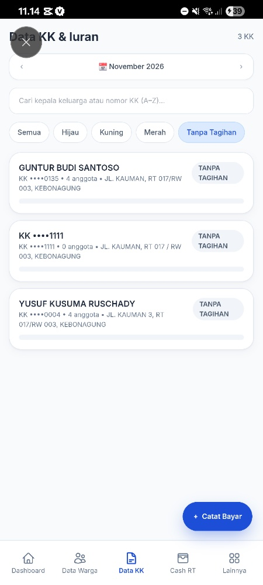

# WargaKITA — Aplikasi Administrasi & Keuangan RT 17 / RW 03 Kebonagung

**WargaKITA** adalah aplikasi Android & Web untuk pengelolaan data kependudukan, iuran bulanan warga, kas RT, agenda kegiatan, dan pelaporan keuangan **RT 17 / RW 03 Kebonagung, Malang**, terintegrasi secara *real-time* dengan **Supabase** (Auth, PostgreSQL + RLS, dan Storage).

---

## Galeri Tampilan Mobile

| Dashboard & Kalender Kegiatan | Data Warga (Mode Gelap) | Data KK & Status Iuran |
| :---: | :---: | :---: |
|  |  |  |

| Catat Pembayaran & Petugas | Cash RT & Riwayat Transaksi | Laporan & Tema / Update |
| :---: | :---: | :---: |
|  |  |  |

---

## Fitur & Fungsi Utama

### 1. Dashboard & Kalender Kegiatan Warga
- **Ringkasan Keuangan & Kependudukan:** Menampilkan total KK aktif, total warga aktif, saldo kas RT terkini, dan total tunggakan bulan berjalan.
- **Grafik Pemasukan 6 Bulan:** Visualisasi tren pemasukan iuran dan kas RT.
- **Kalender Kegiatan Warga:** Kalender interaktif bulanan lengkap dengan agenda kegiatan RT.
- **Sinkronisasi Kalender HP & Pengingat:** Tombol **Simpan ke HP** pada setiap agenda langsung menyimpan acara ke Kalender Android (`CalendarContract`) beserta pengingat otomatis (60 menit & 15 menit sebelum acara), serta notifikasi pengingat HP untuk kegiatan hari ini/besok.

### 2. Data Warga
- **Direktori & Pencarian Cepat:** Pencarian berdasarkan nama, NIK, nomor KK, alamat, atau nomor HP, ditambah filter agama dan status tinggal (`Permanen`, `Kontrak`, `Kost`, `Pindah Domisili`).
- **Tambah Warga Baru (1 KK) & Warga Lama (KK Ada):**
  - **Warga Baru:** Input satu Kartu Keluarga lengkap sekaligus banyak anggota keluarga dalam satu formulir (dengan hubungan keluarga lengkap: `Kepala Keluarga`, `Suami`, `Istri`, `Pasangan`, `Anak`, `Orang Tua`, `Mertua`, `Menantu`, `Cucu`, `Famili Lain`, `Lainnya`).
  - **Warga Lama:** Menambahkan anggota baru ke KK yang sudah terdaftar.
- **Edit & Pindah Domisili:** Jika status warga diubah menjadi **Pindah Domisili**, tagihan bulanannya otomatis menjadi **Tanpa Tagihan**. Jika seluruh anggota KK dihapus, KK kosong otomatis dibersihkan agar tidak masuk daftar tunggakan.

### 3. Data KK & Iuran Bulanan
- **Pemantauan Status Iuran Per KK:** Status warna otomatis (`Hijau` = Lunas, `Kuning` = Sebagian, `Merah` = Belum Bayar, `Tanpa Tagihan` = Pindah/Non-aktif).
- **Catat Pembayaran Iuran:**
  - Pencarian KK A–Z yang cepat.
  - Opsi **Bayar Keseluruhan Tagihan (Semua Kategori)** atau per kategori (`Pembangunan + Voging`, `Rukem + Juri Kunci`, `Keuangan Social`, `17 Agustus`).
  - Metode pembayaran: **QRIS (a.n. Fibriono — Ketua RT 17)**, **Transfer Bank**, dan **Tunai**.
  - **Pilihan Wajib Petugas Pemeriksa Tagihan (A–Z):** `A. Teguh Purwanto`, `Ahmad Abin`, `Jodik Purwanto`, `Novan Hermawan`.
  - **Upload Bukti Foto (Kamera Langsung / Galeri):** Otomatis diunggah ke Supabase Storage.

### 4. Cash RT & Persetujuan Transaksi
- **Grafik Proporsi Pemasukan:** Donut chart per kategori iuran.
- **Riwayat Transaksi Detail:** Menampilkan status persetujuan (`Approved`, `Pending Approval`, `Rejected`), metode bayar, **nama petugas penginput** (untuk pencatatan Bendahara/Sekretaris), serta tombol **Lihat Bukti** dan pop-up **Detail Transaksi** saat diketuk.
- **Pencatatan Kas Masuk & Keluar:** Mendukung lampiran nota/struk dari kamera langsung atau galeri.

### 5. Lainnya, Laporan, Import/Export, Tema & Auto-Update
- **Laporan Keuangan 1 Bulan:** Ringkasan saldo awal, pemasukan per kategori, rincian pengeluaran, dan daftar KK belum lunas.
- **Export & Share Laporan:** **Share / Unduh PNG**, **Share / Unduh PDF** (langsung ke Share Sheet Android), dan **Export Database Warga Global (Excel `.xlsx`)**.
- **Import Massal Warga:** Unduh **Template Excel**, isi banyak KK dan anggota sekaligus, lalu **Import Massal (`.xlsx` / `.csv`)** tanpa input satu per satu.
- **Riwayat Aktivitas Akun:** Setiap akun mencatat log aktivitasnya sendiri dan dapat diketuk untuk melihat detail aktivitas.
- **Tema Aplikasi:** Pilihan **Terang**, **Gelap** (Flat UI kontras tinggi), dan **Ikuti Device** (membaca tema sistem Android secara *real-time*).
- **Cek Update Otomatis:** Memeriksa rilis terbaru dari **GitHub Releases** dan menampilkan notifikasi + pop-up **Update Tersedia** beserta tombol unduh APK.

---

## Matriks Hak Akses (5 Role)

| Role | Email Login | Lihat Warga | Tambah Warga | Edit / Hapus Warga | Catat Bayar & Kas | Approval Transaksi | Kalender & Saldo Awal | Panel Developer |
| :--- | :--- | :---: | :---: | :---: | :---: | :---: | :---: | :---: |
| **Developer Admin** | `developer@wargakita.id` | Ya | Ya | Ya | Ya (Auto-Approved) | Ya | Ya | Ya |
| **Pak RT** | `pakrt17@wargakita.id` | Ya | Ya | Ya | Ya (Auto-Approved) | Ya | Ya | Tidak |
| **Wakil RT** | `wakilrt17@wargakita.id` | Ya | Ya | Hapus saja | Tidak | Ya | Kalender saja | Tidak |
| **Bendahara RT** | `bendahara17@wargakita.id` | Ya | Tidak | Tidak | Ya (Pending Approval) | Tidak | Tidak | Tidak |
| **Sekretaris RT** | `sekretaris17@wargakita.id` | Ya | Ya | Tidak | Tidak | Tidak | Tidak | Tidak |

---

## Cara Kerja & Alur Sistem

### 1. Alur Autentikasi & Keamanan
1. Pengguna login menggunakan username/email `@wargakita.id` via **Supabase Auth**.
2. Saat login pertama kali (`must_change_password = true`), sistem mewajibkan pengguna mengganti password terlebih dahulu.
3. Seluruh tabel PostgreSQL dilindungi oleh **Row Level Security (RLS)** sesuai peran masing-masing.

### 2. Alur Pencatatan Iuran, Kas RT & Persetujuan (*Approval*)
1. **Bendahara RT** atau **Sekretaris RT** mencatat pemasukan iuran atau kas masuk/keluar, wajib memilih **Nama Petugas**, dan melampirkan foto bukti.
2. Transaksi otomatis berstatus **Pending Approval** (kuning) dan memicu **notifikasi di aplikasi maupun notifikasi HP** pada akun **Developer**, **Pak RT**, dan **Wakil RT**.
3. **Developer / Pak RT / Wakil RT** memeriksa bukti foto dan mengetuk **Approve** (hijau) atau **Reject** (merah). Hanya transaksi berstatus **Approved** yang dihitung ke **Saldo Kas RT**.
4. Pencatatan yang dilakukan langsung oleh **Developer**, **Pak RT**, atau **Wakil RT** otomatis berstatus **Approved**.

### 3. Alur Penyimpanan Bukti ke Supabase Storage
Setiap foto bukti pembayaran atau nota kas diunggah ke bucket `receipts` dengan struktur folder dan nama file terstandar:
- **Struktur Folder:** `receipts/<TAHUN>/<BULAN>/<PEMASUKKAN atau PENGELUARAN>/`
- **Format Nama File Iuran Warga:** `Pemasukkan_<YYYY-MM-DD>_<NamaWarga>_<Jam>.jpg`
- **Format Nama File Kas Lainnya / Pengeluaran:** `Lainnya_<Nominal>_<NamaPemasukkan>_<Jam>.jpg` atau `Pengeluaran_<Nominal>_<NamaPengeluaran>_<Jam>.jpg`
- URL publik file disimpan di catatan transaksi sehingga dapat dilihat oleh seluruh pengurus lintas perangkat.

### 4. Alur Build APK & Rilis Otomatis (GitHub Actions)
1. Setiap *push* ke branch `main` pada `WargaKITA-17` menjalankan workflow `.github/workflows/build-apk.yml`.
2. Workflow mengekstrak `WargaKITA_GitHub_Backup.zip`, menyiapkan Java 17 + Android SDK 35 + Gradle 8.9, lalu menjalankan `gradle assembleDebug`.
3. File APK hasil build otomatis dipublikasikan ke **GitHub Releases** sehingga fitur **Cek Update Aplikasi** di HP warga langsung mendeteksi versi terbaru.

---

## Cara Penggunaan Singkat

1. **Login:** Masukkan username (mis. `pakrt17`, `bendahara17`, `wakilrt17`, `sekretaris17`, atau `developer`) dan password Anda.
2. **Mengelola Warga:** Buka tab **Data Warga** &rarr; ketuk **+ Tambah Warga** untuk menambah 1 KK baru atau anggota ke KK yang sudah ada, atau ketuk nama warga untuk mengubah/menghapus data.
3. **Mencatat Iuran:** Buka tab **Data KK** &rarr; ketuk **+ Catat Bayar** &rarr; pilih nama KK &rarr; pilih kategori/bayar keseluruhan &rarr; pilih metode & petugas &rarr; foto bukti &rarr; **Simpan Pembayaran**.
4. **Menyetujui Transaksi (Pak RT / Wakil RT / Developer):** Ketuk ikon **Lonceng (🔔)** di pojok kanan atas atau buka tab **Cash RT** &rarr; cek **Lihat Bukti** &rarr; ketuk **Approve** atau **Reject**.
5. **Mengunduh Laporan & Data Massal:** Buka tab **Lainnya** untuk mengunduh laporan **PNG / PDF**, **Export / Import Excel Warga**, mengubah **Tema (Terang / Gelap / Device)**, dan mengecek **Update Aplikasi**.
