# WargaKITA — Aplikasi Administrasi & Keuangan RT 17 / RW 03 Kebonagung

**WargaKITA** (`v1.17.0` · `versionCode = 29`) adalah aplikasi **Android & Web** berdesain **Android 17 (Material 3 Expressive)** untuk pengelolaan data kependudukan, iuran tahunan warga, kas RT, siaran info lingkungan *real-time*, asisten AI **NawakAI**, dan pelaporan keuangan **RT 17 / RW 03 Kebonagung, Pakisaji, Malang**, terintegrasi dengan **Supabase** (Auth, PostgreSQL + RLS, Storage, Realtime, Edge Functions) serta server **WebSocket (`server.ts`)**.

> **Pembaruan Utama `v1.17.0` (`versionCode = 29`):**
> - **Android 17 (Material 3 Expressive) & Dark Mode Dinamis:** Redesign menyeluruh di 5 tab (*Dashboard, Data Warga, Data KK & Iuran, Cash RT, Lainnya*), *Desktop Navigation Rail*, *Bottom Navigation Bar* mobile, mode **Terang / Gelap / Otomatis Sistem**, serta **4 palet warna Material You** (*Samudra RT 17, Zamrud Asri, Violet Senja, Koral Hangat*) yang menyelaraskan seluruh UI dan grafik.
> - **Aturan Iuran Tahunan (1×/Tahun per Kategori) & Tunggakan Manual Beda Tahun (`010`):** Dukungan cicilan lintas bulan, akumulasi rincian piutang per tahun & per kategori, pelunasan otomatis FIFO tahun terlama, navigasi lintas tahun (`2026 ↔ 2027`), serta input/koreksi tunggakan historis tahun sebelumnya (`>= 2020`).
> - **Siaran Info Warga Real-Time WebSocket (`server.ts`):** Penyiaran instan (*Info Ronda, Kerja Bakti, Pengumuman RT, Agenda Warga*) ke semua perangkat aktif, pemisahan tab *Info Warga* vs *Approval Kas*, serta kontrol khusus *Developer, Pak RT & Wakil RT* untuk siaran info dan edit Kartu Ucapan Ulang Tahun.
> - **Laporan Kas Bulanan & Per Petugas PDF + 14 Hak Akses Granular:** Cakupan petugas terpilih otomatis sesuai akun login, perbandingan *Month-over-Month (MoM)*, urutan anggota KK baku (`009` + `security_invoker`), serta 14 centang izin granular di Panel Developer.

---

## Daftar Isi
1. [Tab Dashboard, Notifikasi Live & Kalender Warga](#1-tab-dashboard-notifikasi-live--kalender-warga)
2. [Asisten AI — NawakAI](#2-asisten-ai--nawak-ai)
3. [Tab Data Warga & Urutan Anggota KK Baku](#3-tab-data-warga--urutan-anggota-kk-baku)
4. [Tab Data KK & Iuran Tahunan + Tunggakan Lintas Tahun](#4-tab-data-kk--iuran-tahunan--tunggakan-lintas-tahun)
5. [Tab Cash RT, Grafik Donat & Laporan Per Petugas](#5-tab-cash-rt-grafik-donat--laporan-per-petugas)
6. [Tab Lainnya, Tema Material You & Laporan](#6-tab-lainnya-tema-material-you--laporan)
7. [Panel Khusus Developer & 14 Hak Akses Granular](#7-panel-khusus-developer--14-hak-akses-granular)
8. [Matriks Hak Akses & Arsitektur Sistem](#8-matriks-hak-akses--arsitektur-sistem)

---

## 1. Tab Dashboard, Notifikasi Live & Kalender Warga

  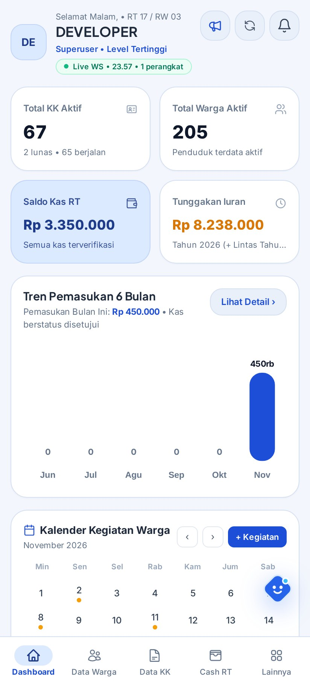
  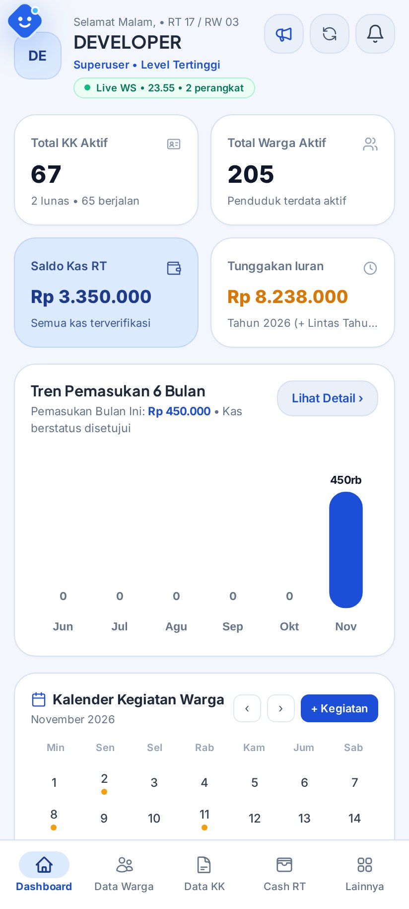
  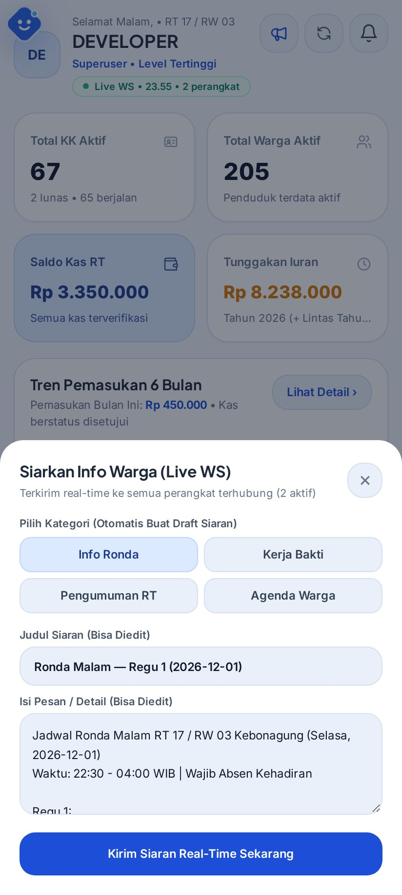
  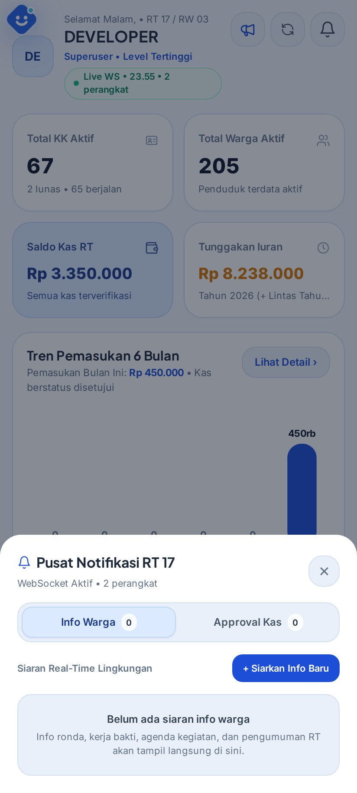

Tab **Dashboard** menjadi pusat kendali cepat bagi pengurus dan warga untuk memantau kondisi RT 17 secara *real-time*:

- **Navigasi Responsif Material 3 Expressive:** Pada layar ponsel menggunakan *Bottom Navigation Bar* yang ringkas (`<= 390px`), sedangkan di tablet/desktop otomatis menampilkan **Desktop Navigation Rail** di sisi kiri lengkap dengan indikator status koneksi **Live WebSocket**.
- **4 Kartu KPI & Grafik Pemasukan 6 Bulan:** Menampilkan **Total KK Aktif**, **Total Warga Aktif**, **Saldo Kas RT (Approved)**, dan **Tunggakan Iuran** periode aktif, disertai **grafik batang tren pemasukan 6 bulan terakhir** dengan desain kapsul membulat yang warnanya otomatis mengikuti palet Material You terpilih.
- **Pusat Notifikasi Real-Time WebSocket & Siaran Info Warga:**
  - Memisahkan tab **Info Warga** (khusus berisi info relevan seperti *Info Ronda, Kerja Bakti, Agenda Warga, Pembayaran Iuran, Pengumuman RT* tanpa tercampur spam *pending approval*) dengan tab **Approval Kas**.
  - Menu **Siarkan Info Baru** (`canBroadcastInfo`) khusus muncul untuk **Developer, Pak RT, dan Wakil RT**, lengkap dengan 4 tombol kategori *template otomatis* yang masih dapat diedit sebelum disiarkan langsung ke seluruh perangkat aktif via WebSocket.
- **Kalender Kegiatan Warga & Kartu Ucapan Ulang Tahun:** Membedakan **Agenda Resmi RT** (termasuk jadwal ronda malam) dan **Ulang Tahun Kepala Keluarga Permanen**, dilengkapi sinkronisasi ke Kalender Android, notifikasi berkala HP, serta **Kartu Ucapan Ulang Tahun** (3 tema visual + 6 template sesuai usia dengan tombol Unduh PNG & Kirim WhatsApp — hak edit kartu ucapan dibatasi khusus **Developer, Pak RT, dan Wakil RT**).

---

## 2. Asisten AI — NawakAI

  
  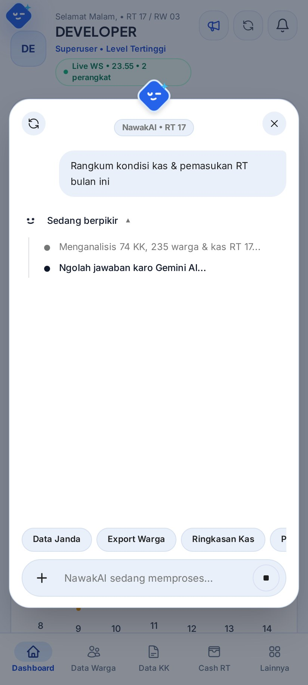
  
  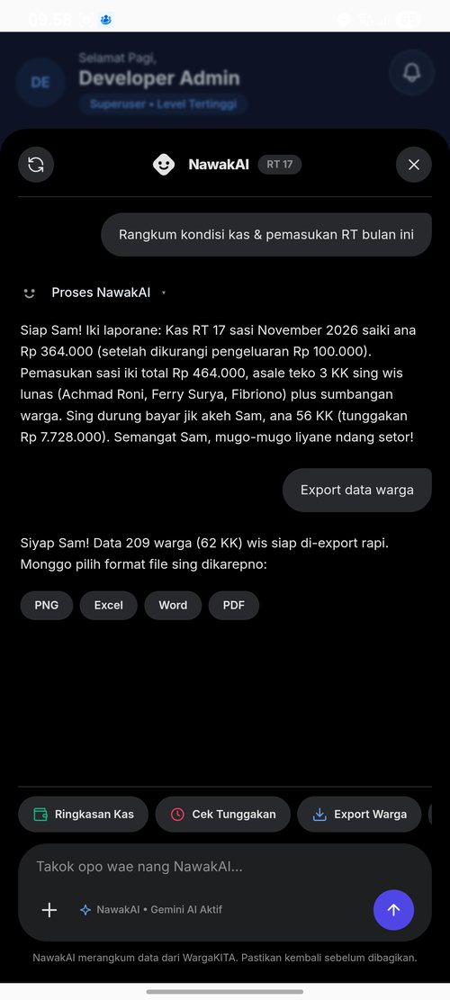

  
  
  

**NawakAI** adalah asisten cerdas interaktif RT 17 berbentuk maskot **Wajik Biru** mengambang (*draggable*, posisi tersimpan otomatis) dengan antarmuka **bergaya Gemini**:

- **NLU 5 Lapis Anti-Typo & Bahasa Jawa-Malangan:** Memahami 150+ singkatan WA dan dialek Malangan (`brp`, `jnd`, `rondo`, `drg`, `byr`, `saiki`, `sopo`), koreksi typo otomatis *Damerau-Levenshtein (≤ 2)*, *disambiguasi nama ganda*, serta memori percakapan *multi-turn* untuk revisi draft instan.
- **Voice Command & 7 Audio ElevenLabs *Offline*:** Mendukung perintah suara langsung `id-ID` (*waveform* 14 bar di dalam kotak chat), tombol baca suara TTS (`🔊/🔇`), tombol Henti Paksa (`□`), dan 6 ekspresi maskot yang sinkron dengan waktu WIB Malang.
- **Pembaca Semua Jenis File + OCR Lokal:** Tombol `+` mendukung pembacaan **PNG, JPG, WEBP, PDF (hingga 10 halaman + OCR Tesseract), Excel/CSV/ODS, Word (`.docx`/`.doc`), dan TXT/JSON**, sekaligus mampu mendeteksi data warga/KK siap import anti-duplikat.
- **Eksekusi Terkonfirmasi & Export 4 Format:** Khusus **Developer, Pak RT, dan Wakil RT** dapat menjalankan pelunasan KK (termasuk **pembayaran iuran tahunan lintas tahun FIFO**), *batch approval* kas pending, maupun ekspor data warga terurut baku ke **PNG, Excel, Word `.docx` OOXML, dan PDF** dengan filter status (*Permanen, Kontrak, Kost, Janda, Pindah Domisili, Meninggal Dunia*).

---

## 3. Tab Data Warga & Urutan Anggota KK Baku

  
  
  
  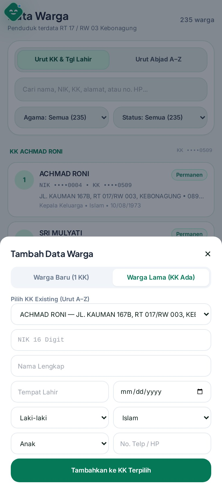
  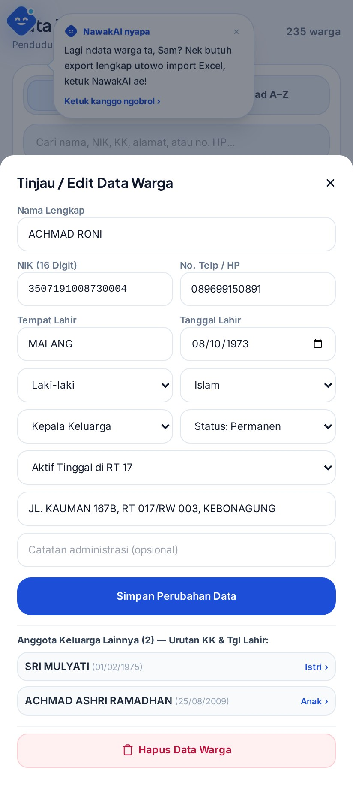
  

Tab **Data Warga** mengelola direktori penduduk RT 17 secara terpusat dengan struktur keluarga yang konsisten:

- **Urutan Baku Anggota KK (`sortKKMembers` & `v_residents_kk_ordered`):** Anggota dalam setiap KK selalu tersusun rapi mengikuti standar resmi: **`Kepala Keluarga → Istri/Suami → Anak → Menantu → Cucu → Orang Tua Laki-laki/Perempuan → Mertua → Famili Lain → Lainnya`**, diurutkan dari **tanggal lahir tertua ke termuda** di seluruh tampilan aplikasi dan dokumen export.
- **Sortir Fleksibel & Filter Ringkas:** Pengguna dapat beralih cepat antara mode sortir **Urut KK & Tgl Lahir** atau **Urut Abjad A–Z**, dilengkapi pencarian **Nama, NIK, No. KK, Alamat, No. HP**, filter **Agama**, serta filter status (*Semua, Permanen, Kontrak, Kost, Tidak Aktif di RT 17, Pindah Domisili, Meninggal Dunia*).
- **Pendaftaran Warga Baru (1 KK) & Warga Lama (KK Ada):** Memisahkan form input keluarga baru dari penambahan anggota baru pada KK terdaftar, dengan validasi hubungan keluarga lengkap.
- **Tinjau, Edit & Proteksi NIK:** Alamat KK otomatis tersinkron ke tabel `households`; nomor NIK disensor otomatis bagi akun yang tidak memiliki izin `canUnmaskNik`.

---

## 4. Tab Data KK & Iuran Tahunan + Tunggakan Lintas Tahun

  
  
  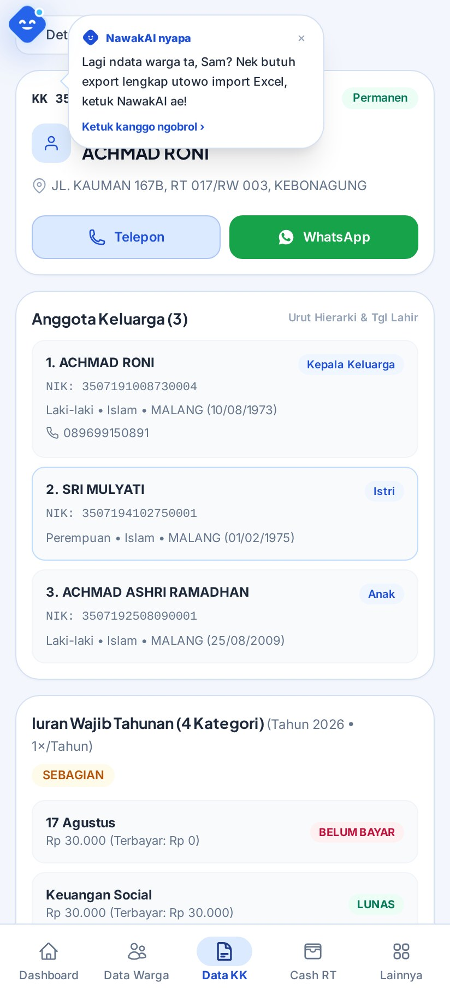
  
  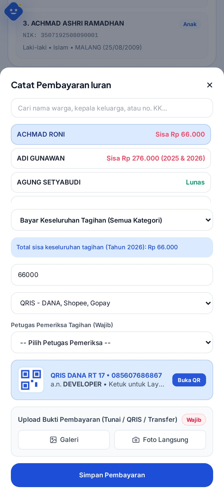
  
  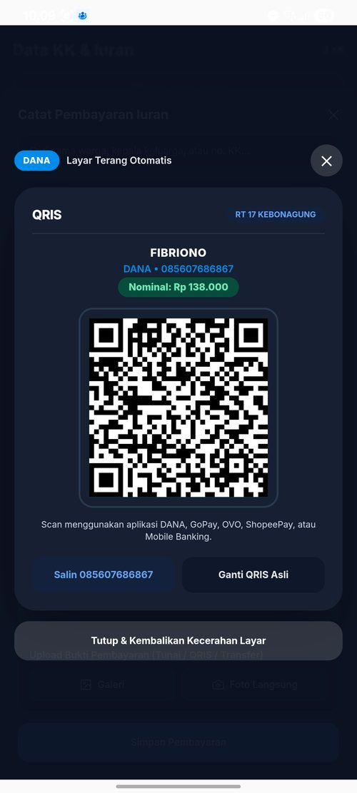

Tab **Data KK & Iuran** kini beroperasi penuh dengan **sistem tagihan tahunan (`010_annual_dues_and_manual_arrears.sql`)**:

- **Aturan Iuran Wajib Tahunan (1×/Tahun per Kategori) & Cicilan Lintas Bulan:**
  - Setiap KK wajib melunasi **4 kategori iuran tahunan** (*17 Agustus `Rp 30rb`*, *Keuangan Social `Rp 30rb`*, *Pembangunan + Fogging `Rp 36rb`*, dan *Rukem + Juru Kunci `Rp 42rb`* — total **`Rp 138.000/thn`**; kategori **Janda** hanya wajib *Rukem + Juru Kunci `Rp 42.000/thn`*; **Kost/Pindah/Meninggal** bebas tagihan).
  - Tagihan otomatis dikonsolidasikan **1 tagihan per tahun per kategori (`period_month = 1`)**. Jika warga mencicil sebagian di bulan November lalu melanjutkan pembayaran di Desember, sisa kewajiban dan status **Sebagian** tetap terbawa utuh tanpa membuat tagihan ganda.
- **Tunggakan Manual Beda Tahun & Akumulasi Rincian Piutang (`showManualArrearsModal`):**
  - Petugas berwenang (`canManageManualArrears`) dapat membuka menu **Atur Tunggakan Manual** di Detail KK untuk mencatat atau menyesuaikan nominal tunggakan tahun-tahun sebelumnya (`>= 2020`) per kategori iuran.
  - Kartu KK dan Detail KK menjabarkan **rincian piutang per tahun & per kategori** beserta akumulasi totalnya, tombol **Ingatkan WhatsApp** santun otomatis, serta pelunasan otomatis memotong tahun terlama lebih dulu (*FIFO*).
  - Pergantian periode bulan (`‹` / `›`) otomatis berpindah tahun (`2026 ↔ 2027`), dan lencana kartu menampilkan **`LUNAS <Tahun>`** agar status tahun berjalan tetap akurat meski ada catatan tunggakan tahun lalu.
- **Filter Cepat & Pembayaran QRIS Layar Penuh:** Tersedia 4 kartu filter cepat (**Wajib Penuh, Janda Rukem, Kost Bebas, Menunggak**), pencarian KK, QRIS layar penuh **DANA `085607686867` a.n. `FIBRIONO`** dengan kecerahan layar otomatis 100%, serta penguncian kategori otomatis khusus 4 petugas Bendahara RT.

---

## 5. Tab Cash RT, Grafik Donat & Laporan Per Petugas

  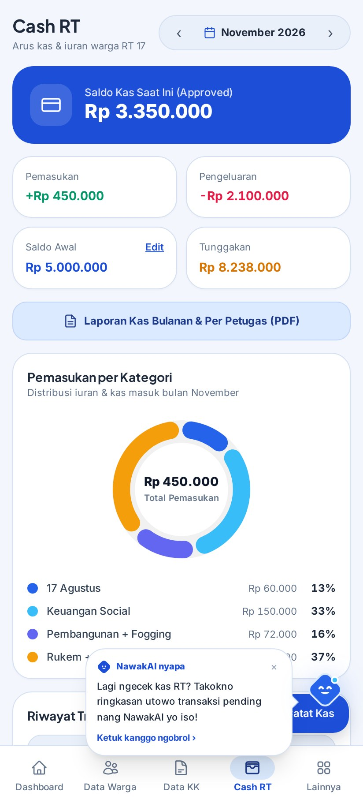
  
  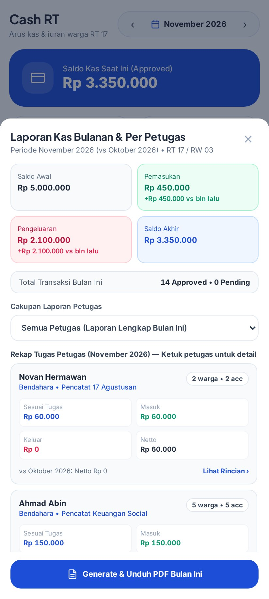
  
  
  
  
  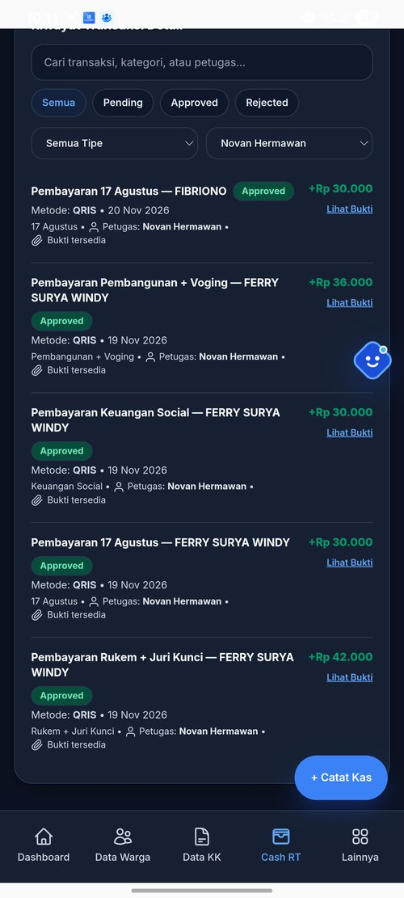

Tab **Cash RT** mengelola arus kas masuk/keluar secara transparan, akurat, dan teraudit:

- **Kartu Saldo, KPI & Grafik Donat Selaras Material You:** Menampilkan **Saldo Kas Saat Ini (Approved)**, **Pemasukan**, **Pengeluaran**, **Saldo Awal** (dengan tombol *Edit* khusus izin `canEditOpening`), **Tunggakan**, serta **Grafik Donat seluruh kategori pemasukan** berpalet warna sesuai tema aktif dengan *tooltip* di sisi luar irisan agar angka tengah selalu terbaca jelas.
- **Laporan Kas Bulanan & Per Petugas + Export PDF (`buildMonthlyCashOfficerReport`):**
  - Menyajikan perbandingan **Bulan Ini vs Bulan Sebelumnya (Month-over-Month)** untuk pemasukan, pengeluaran, dan surplus bersih, lengkap dengan rincian per kategori dan daftar warga pembayar.
  - **Cakupan Petugas Otomatis Terpilih:** Saat dibuka oleh salah satu dari **4 Bendahara RT** (*Novan Hermawan, Ahmad Abin, A. Teguh Purwanto, Jodik Purwanto*) maupun pengurus lain, laporan langsung menyorot cakupan tugas dan daftar setoran warga milik akun yang login, siap ekspor ke **PDF cetak**.
- **Riwayat Transaksi Detail & Approval Kas:** Pencarian teks *anti-loncat scroll*, filter Status (**Semua, Pending, Approved, Rejected**), Tipe, dan Petugas dengan paginasi 10 item per halaman, foto nota dari Supabase Storage, **10 kategori pemasukan tambahan**, serta alur persetujuan (*ACC / Tolak*) dengan dialog konfirmasi *frosted-blur*.

---

## 6. Tab Lainnya, Tema Material You & Laporan

  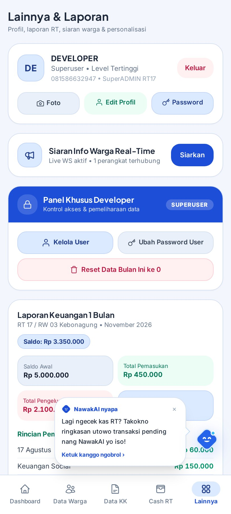
  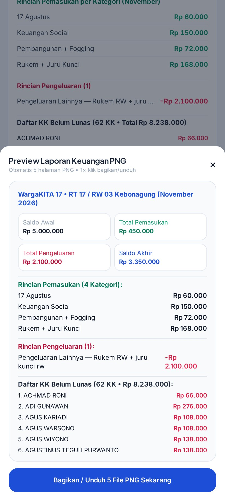
  
  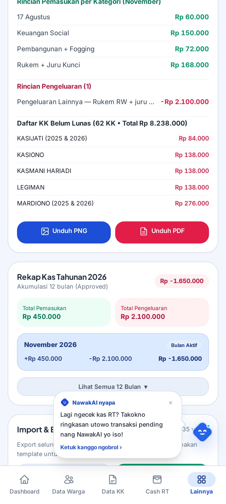
  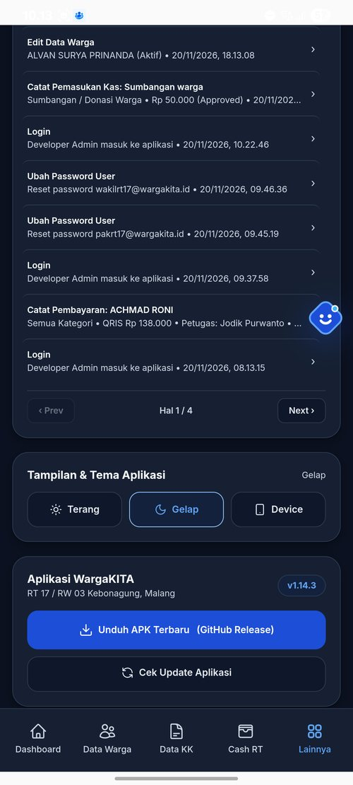
  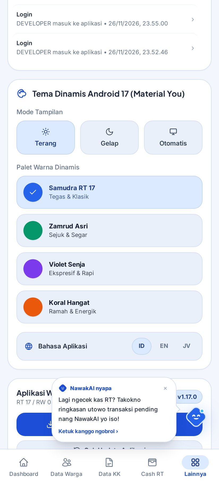
  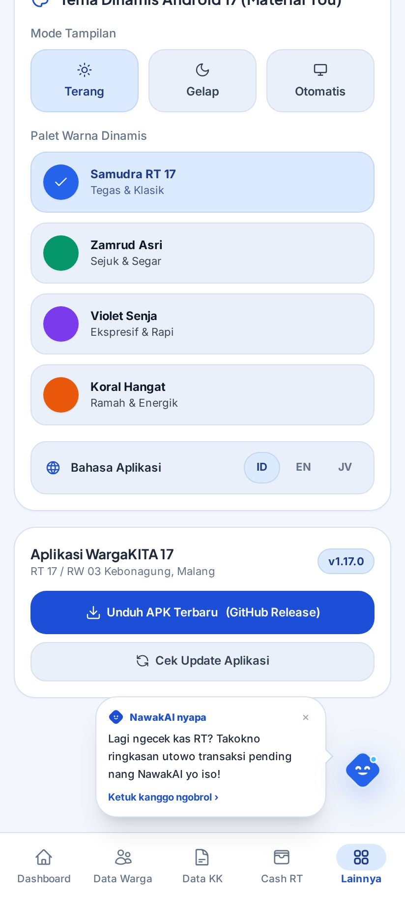

Tab **Lainnya** menghimpun pengaturan personalisasi tampilan, laporan keuangan, ekspor/impor massal, dan pembaruan aplikasi:

- **Pengaturan Tema Material You & Mode Gelap Dinamis:**
  - **3 Mode Tampilan:** **Terang**, **Gelap**, dan **Otomatis** (mengikuti preferensi perangkat Android/browser).
  - **4 Pilihan Palet Warna Material You:** **Samudra RT 17** (biru tegas), **Zamrud Asri** (hijau sejuk), **Violet Senja** (ungu ekspresif), dan **Koral Hangat** (oranye ramah), lengkap dengan pratinjau *swatch* warna dan pemilih bahasa ringkas (**`ID` / `EN` / `JV`**).
- **Laporan Keuangan 1 Bulan (Multi-PNG & PDF Lengkap):** Merangkum Saldo Awal, seluruh kategori pemasukan (`allIncomeByCat`), pengeluaran, Saldo Akhir, dan daftar lengkap KK belum lunas, siap dibagikan sebagai **Multi-PNG tajam (16 KK/halaman)** maupun **PDF A4 multi-halaman** (dikontrol hak akses `canExportReports`).
- **Rekap Kas Tahunan, Import/Export Excel & Kesehatan Sistem:** Menyorot **Bulan Aktif** di bagian teratas rekap tahunan, menyediakan **Template Excel, Export Global, dan Import Massal Warga**, riwayat aktivitas audit berpaginasi, serta pemeriksaan pembaruan APK otomatis dari **GitHub Releases**.

---

## 7. Panel Khusus Developer & 14 Hak Akses Granular

  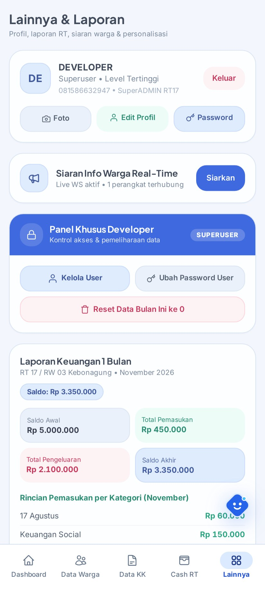
  
  
  
  
  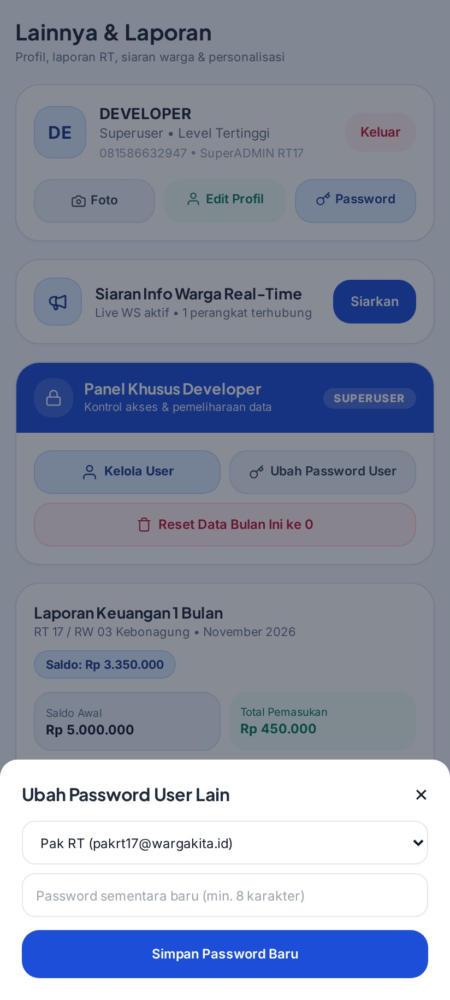

Khusus akun `developer@wargakita.id`, tersedia **Panel Khusus Developer (`SUPERUSER`)** untuk kendali sistem dan otorisasi penuh:

- **Kelola User Login (`005_developer_user_management.sql`):** Menambah, mengedit, mencari, mengganti password sementara, hingga menghapus akun (`developer_list_users`, `developer_create_user`, `developer_update_user`, `developer_delete_user`) secara aman tanpa kendala *foreign key*.
- **14 Centang Hak Akses Granular (`custom_permissions` & `010`):** Developer dapat mengatur izin spesifik per akun dan langsung tersinkron hingga level database RLS (`public.user_has_permission()`):
  1. Lihat Data Warga & KK (`canViewWarga`)
  2. Tambah Warga Baru (`canAddWarga`)
  3. Edit Data Warga & Alamat (`canEditWarga`)
  4. Hapus Data Warga (`canDeleteWarga`)
  5. Catat Pembayaran Iuran (`canPay`)
  6. Catat Transaksi Kas RT (`canCash`)
  7. Approval Kas / ACC & Tolak (`canApprove`)
  8. Edit Saldo Awal Kas (`canEditOpening`)
  9. Kelola Agenda Resmi RT (`canEditCalendar`)
  10. Siarkan Info Warga Real-Time (`canBroadcastInfo`)
  11. Edit Kartu Ucapan Ulang Tahun (`canEditBirthdayCard`)
  12. Atur Tunggakan Manual Beda Tahun (`canManageManualArrears`)
  13. Unduh Laporan PDF / PNG / Excel (`canExportReports`)
  14. Lihat NIK Penuh Tanpa Sensor (`canUnmaskNik`)
- **Reset Data Periode Berjalan:** Fitur pengujian cepat untuk mereset data periode berjalan ke nol bila diperlukan oleh Developer.

---

## 8. Matriks Hak Akses & Arsitektur Sistem

| Role Database | Email Contoh | Warga (Lihat/Tambah/Edit/Hapus) | Bayar Iuran & Kas RT | Approval Kas | Tunggakan Manual | Siaran Info & Edit Ultah | Agenda & Saldo Awal | Unduh Laporan | Lihat NIK Penuh | Panel Developer |
| :--- | :--- | :---: | :---: | :---: | :---: | :---: | :---: | :---: | :---: | :---: |
| **Developer Admin** | `developer@wargakita.id` | Penuh | Auto-Approved | Ya | Ya | Ya | Penuh | Ya | Ya | Ya |
| **Pak RT** | `pakrt17@wargakita.id` | Penuh | Auto-Approved | Ya | Ya | Ya | Penuh | Ya | Ya | Tidak |
| **Wakil RT** | `wakilrt17@wargakita.id` | Lihat, Tambah, Hapus | Tidak | Ya | Ya | Ya | Agenda saja | Ya | Tidak | Tidak |
| **Bendahara RT** | `novan@wargakita.id`, `ahmadabin@wargakita.id`, `teguh@wargakita.id`, `jodik@wargakita.id` | Lihat saja | Pending Approval | Tidak | Ya | Tidak | Tidak | Ya | Tidak | Tidak |
| **Sekretaris RT** | `sekretaris17@wargakita.id` | Lihat & Tambah | Tidak | Tidak | Tidak | Tidak | Tidak | Ya | Ya | Tidak |

*(Seluruh izin bawaan di atas dapat dikustomisasi per akun oleh **Developer Admin** melalui **14 centang `custom_permissions`** di menu **Kelola User Login**).*

### Arsitektur Teknis
1. **Autentikasi, RLS & Migrasi Terstruktur (`supabase/005`–`010`):** Login Supabase Auth + proteksi *Row Level Security (RLS)* yang membaca `user_has_permission()`, view berkeamanan `security_invoker = true` (`v_residents_kk_ordered`), serta konsolidasi tagihan tahunan (`ensure_period_dues` & `upsert_manual_household_due`).
2. **Backend Express & WebSocket (`server.ts`):** Menyajikan aplikasi Vite/SPA sekaligus kanal WebSocket `/ws` dan endpoint `/api/notifications/*` untuk penyiaran notifikasi lingkungan secara *real-time* beserta pelacakan jumlah perangkat aktif.
3. **Asisten AI Hibrida & Offline Assets:** Supabase Edge Function `nawak-ai` + *silent fallback* NLU 5 lapis lokal + OCR & pembaca dokumen lokal (`Tesseract.js`, `PDF.js`, `Mammoth.js`, `SheetJS`, `jsPDF`) + 7 audio ElevenLabs MP3 *offline*.
4. **Build & Rilis APK Otomatis:** GitHub Actions (`.github/workflows/build-apk.yml`) membangun APK Android (`versionCode = 29`, `versionName = "1.17.0"`), menandatanganinya dengan *keystore* rilis dari GitHub Secrets, dan mempublikasikan rilis ke **GitHub Releases**.

---

## Riwayat Perubahan
Lihat rincian lengkap pembaruan fitur, antarmuka, skema SQL, dan perbaikan bug pada [CHANGELOG.md](CHANGELOG.md).
