# WargaKITA — Aplikasi Administrasi & Keuangan RT 17 / RW 03 Kebonagung

**WargaKITA** (`v1.17.0` · `versionCode = 30`) adalah aplikasi **Android & Web** berdesain **Android 17 (Material 3 Expressive)** untuk pengelolaan data kependudukan, iuran tahunan warga, kas RT, siaran info lingkungan *real-time*, asisten AI **NawakAI**, dan pelaporan keuangan **RT 17 / RW 03 Kebonagung, Pakisaji, Malang**, terintegrasi dengan **Supabase** (Auth, PostgreSQL + RLS, Storage, Realtime, Edge Functions) serta server **WebSocket (`server.ts`)**.

> **Sorotan Rilis `v1.17.0` (`Version Code: 30`):**
> - **Unduh & Pasang Update APK Langsung Di Dalam Aplikasi + Sub-APK `Version Code`:** Menekan tombol update tidak lagi melempar ke browser — APK terunduh langsung di dalam aplikasi dengan **progress bar persentase & MB real-time**. Mendukung sub-APK bernomor (`WargaKITA-RT17-v1.17.0-VersionCode-30.apk`, dst.), mengarahkan seluruh versi lama (`v1.15.x`, `v1.16.x`, hingga build `v1.17.0` sebelumnya) ke rilis terbaru, popup otomatis di **Dashboard**, serta notifikasi latar belakang bagi perangkat yang belum dibuka.
> - **Android 17 (Material 3 Expressive) + 4 Palet Material You & Dark Mode:** Redesign menyeluruh di 5 tab utama, *Desktop Navigation Rail*, mode **Terang / Gelap / Otomatis**, ikon *pull-to-refresh* selaras warna tema aktif, serta 4 palet warna dinamis (*Samudra RT 17, Zamrud Asri, Violet Senja, Koral Hangat*).
> - **Aturan Iuran Tahunan (1×/Tahun per Kategori) & Tunggakan Manual Lintas Tahun (`010`):** Cicilan lintas bulan, rincian piutang per tahun & kategori, pelunasan otomatis FIFO tahun terlama, navigasi tahun (`2026 ↔ 2027`), serta koreksi tunggakan historis (`>= 2020`).
> - **Stabilitas Gulir, Tombol Back Dropdown & 14 Hak Akses Granular:** Perbaikan anti-loncat ke atas saat menggulir daftar ke bawah, tombol Back Android menutup dropdown blur terbuka lebih dulu, dropdown anti-salah pencet saat scroll, siaran info warga *real-time* WebSocket, laporan kas per petugas PDF, serta 14 izin granular di Panel Developer.

---

## Daftar Isi (Menu, Sub-Menu & Kegunaan)

<strong>Navigasi Lengkap Menu & Sub-Menu WargaKITA v1.17.0</strong>

1. [**Tab 1 — Dashboard & Pusat Kendali**](#1-tab-1--dashboard--pusat-kendali)
   - **1.1 Ringkasan KPI & Grafik Tren 6 Bulan:** Pantau total KK aktif, warga aktif, saldo kas approved, piutang iuran, dan grafik batang pemasukan 6 bulan (Desktop Navigation Rail & Mobile).
   - **1.2 Kalender Kegiatan Warga & Jadwal Ronda:** Lihat kalender bulanan, Agenda Resmi RT, jadwal ronda malam, dan sinkronisasi ke Kalender Android.
   - **1.3 Daftar Ulang Tahun & Kartu Ucapan Ulang Tahun:** Cetak/kirim kartu ucapan 3 tema visual + 6 template sesuai usia ke WhatsApp (edit kartu khusus *Developer, Pak RT, Wakil RT*).
   - **1.4 Pusat Notifikasi & Siaran Info Warga Real-Time:** Pemisahan tab *Info Warga* vs *Approval Kas* serta formulir *Siarkan Info Baru* langsung ke seluruh perangkat aktif via WebSocket.
2. [**Asisten Cerdas — NawakAI (Panduan Khusus & Fitur Lengkap)**](#2-asisten-cerdas--nawak-ai-panduan-khusus--fitur-lengkap)
   - **2.1 Beranda Cepat & Antarmuka Gemini (Terang & Gelap OLED):** Tombol mengambang *draggable* dengan 6 ekspresi maskot dan akses 1 ketuk ke perintah populer.
   - **2.2 Eksekusi Perintah Data RT Real-Time (Kas, Tunggakan, Janda, Ronda, Briefing & Draft WA):** Tanya-jawab bahasa Indonesia, singkatan WA, hingga dialek Jawa-Malangan (*NLU 5 lapis anti-typo*).
   - **2.3 Menu Lampiran `+` (Foto, Kamera, File Dokumen, Google Drive) & OCR Lokal:** Baca gambar nota/KTP/KK, PDF, Excel, dan Word langsung untuk dirangkum atau diimpor ke database.
   - **2.4 Voice Input Inline, Suara TTS Offline & Export Data Warga 4 Format:** Perintah suara 14-bar waveform, pembacaan suara lokal, filter status warga, dan export **PNG, Excel, Word `.docx`, & PDF**.
3. [**Tab 2 — Data Warga**](#3-tab-2--data-warga)
   - **3.1 Direktori Terurut Baku & Mode Sortir Ganda:** Tampilan *Urut KK & Tgl Lahir* (`Kepala → Istri → Anak → dst`) atau *Urut Abjad A–Z*.
   - **3.2 Pencarian Instan & Filter Status/Agama:** Filter *Permanen, Kontrak, Kost, Tidak Aktif, Pindah Domisili, Meninggal Dunia* serta agama.
   - **3.3 Tambah Warga Baru (1 KK) & Tambah Warga Lama (KK Ada):** Input keluarga baru lengkap atau penambahan anggota pada KK terdaftar.
   - **3.4 Tinjau, Edit Data Warga & Sensor NIK Otomatis:** Pembaruan profil, status *Meninggal Dunia*, sinkronisasi alamat ke tabel `households`, dan proteksi NIK.
4. [**Tab 3 — Data KK & Iuran Tahunan**](#4-tab-3--data-kk--iuran-tahunan)
   - **4.1 Navigasi Periode Lintas Tahun & 4 Kartu Filter Cepat:** Pergantian bulan/tahun (`2026 ↔ 2027`), progres kepatuhan, dan filter *Wajib Penuh, Janda Rukem, Kost Bebas, Menunggak*.
   - **4.2 Detail KK, Urutan Anggota & Pengaturan Tunggakan Manual Beda Tahun:** Rincian piutang lintas tahun, tombol *Ingatkan WhatsApp*, dan modal koreksi tunggakan historis (`>= 2020`).
   - **4.3 Catat Pembayaran Iuran, Cicilan FIFO & QRIS Layar Penuh:** Pembayaran cicilan lintas bulan, pelunasan otomatis tahun terlama (*FIFO*), bukti wajib foto, serta **QRIS Layar Penuh DANA** dengan kecerahan layar otomatis 100%.
5. [**Tab 4 — Cash RT & Pelaporan Petugas**](#5-tab-4--cash-rt--pelaporan-petugas)
   - **5.1 Kartu Saldo, KPI & Edit Saldo Awal:** Pemantauan Saldo Approved, Pemasukan, Pengeluaran, Saldo Awal, dan Tunggakan.
   - **5.2 Grafik Donat Pemasukan Material You:** Distribusi seluruh kategori pemasukan dengan tooltip tepi luar dan palet warna sesuai tema aktif.
   - **5.3 Laporan Kas Bulanan & Per Petugas (PDF):** Perbandingan *Month-over-Month (MoM)*, cakupan otomatis sesuai Bendahara login, daftar pembayar, dan cetak PDF.
   - **5.4 Riwayat Transaksi Detail, Catat Kas (10 Kategori) & Approval Kas:** Pencarian anti-loncat scroll, paginasi 10 item, foto nota, dan konfirmasi *ACC / Tolak* berlatar blur.
6. [**Tab 5 — Lainnya, Tema Material You & Update In-App**](#6-tab-5--lainnya-tema-material-you--update-in-app)
   - **6.1 Profil Akun, Edit Profil & Ganti Password:** Pengelolaan nama tampilan, nomor HP/WA, jabatan, dan foto profil per pengguna.
   - **6.2 Laporan Keuangan 1 Bulan (Multi-PNG & PDF) & Rekap Kas Tahunan:** Rincian saldo, daftar lengkap KK belum lunas, dan *highlight* Bulan Aktif di rekap 12 bulan.
   - **6.3 Import & Export Excel Database Warga + Riwayat Aktivitas:** Template Excel terformat, Export Global, Import massal anti-duplikat, dan log audit berpaginasi.
   - **6.4 Tema Dinamis Material You (4 Palet & Mode Terang/Gelap/Otomatis) + Bahasa:** Pratinjau langsung *Samudra RT 17, Zamrud Asri, Violet Senja, Koral Hangat* dan bahasa `ID / EN / JV`.
   - **6.5 Info Aplikasi & Pengunduh APK Dalam Aplikasi (`v1.17.0`):** Unduhan APK native dengan *progress bar* langsung di aplikasi, deteksi pembaruan pada versi yang sama, dan pemicu pemasang Android.
7. [**Panel Khusus Developer & 14 Hak Akses Granular**](#7-panel-khusus-developer--14-hak-akses-granular)
   - **7.1 Kelola User Login & 14 Centang Izin Granular (`custom_permissions`):** Manajemen akun penuh yang tersinkron langsung ke PostgreSQL RLS.
   - **7.2 Ubah Password User & Reset Data Periode Berjalan:** Pemulihan akses akun pengurus dan utilitas pembersihan periode pengujian.
8. [**Matriks Hak Akses & Arsitektur Sistem**](#8-matriks-hak-akses--arsitektur-sistem)

---

## 1. Tab 1 — Dashboard & Pusat Kendali

  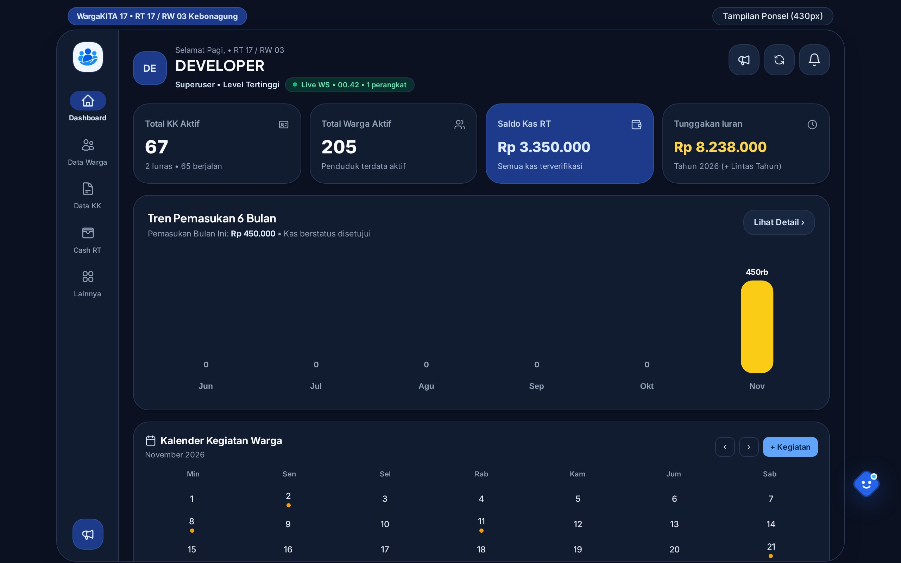

  
  
  
  
  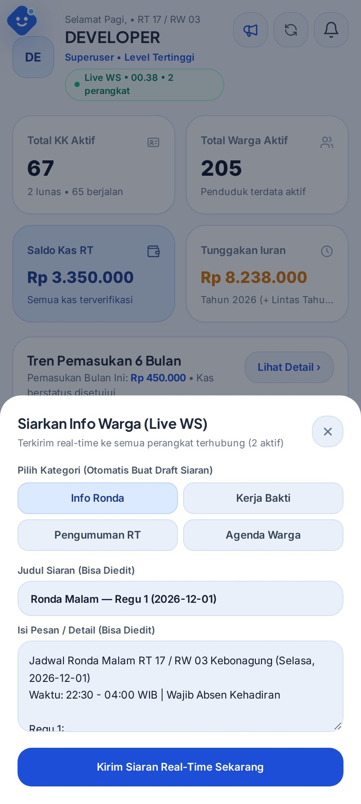

Tab **Dashboard** adalah pusat kendali utama bagi pengurus dan warga untuk memantau ringkasan operasional RT 17 secara *real-time*:

- **1.1 Ringkasan KPI & Grafik Tren 6 Bulan (`dash_desktop.jpg`, `dash_1.jpg`):**
  - Responsif otomatis antara **Bottom Navigation Bar** di ponsel dan **Desktop Navigation Rail** di tablet/desktop lengkap dengan indikator **Live WS**.
  - Menampilkan 4 kartu KPI utama (**Total KK Aktif**, **Total Warga Aktif**, **Saldo Kas RT Approved**, **Tunggakan Iuran**) dan grafik batang kapsul 6 bulan terakhir yang menyesuaikan warna tema Material You aktif.
- **1.2 Kalender Kegiatan Warga & Jadwal Ronda (`dash_2.jpg`):**
  - Memisahkan **Agenda Resmi RT** (termasuk jadwal ronda malam terjadwal) dari **Ulang Tahun Warga Permanen**, dilengkapi tombol **`+ Kegiatan`** (`canEditCalendar`) dan sinkronisasi otomatis ke aplikasi Kalender Android.
- **1.3 Kartu Ucapan Ulang Tahun (`dash_3.jpg`):**
  - Menampilkan pemilih Kepala Keluarga, **6 template ucapan otomatis sesuai usia** (*Resmi, Hormat Sesepuh ≥55 Th, Santai, Lucu Malangan, Awet Muda, Islami*), **3 tema kartu visual** (*Biru RT 17, Navy Emas, Hijau Segar*), serta tombol **Unduh Gambar PNG** dan **Kirim Langsung ke WhatsApp Warga**. Hak sunting kartu dibatasi khusus **Developer, Pak RT, dan Wakil RT**.
- **1.4 Pusat Notifikasi & Siaran Info Warga Real-Time (`dash_4.jpg`, `dash_5.jpg`):**
  - Memisahkan tab **Info Warga** (*Info Ronda, Kerja Bakti, Pengumuman RT, Agenda Warga, Pembayaran*) dari tab **Approval Kas** agar informasi warga tidak tenggelam oleh antrean transaksi.
  - Tombol **Siarkan Info Baru** (`canBroadcastInfo`) khusus **Developer, Pak RT, dan Wakil RT** menyediakan 4 template otomatis siap sunting yang disiarkan seketika via WebSocket & Supabase Realtime ke semua HP aktif.

---

## 2. Asisten Cerdas — NawakAI (Panduan Khusus & Fitur Lengkap)

  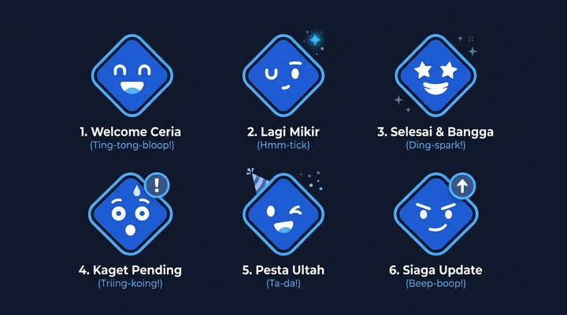
  
  
  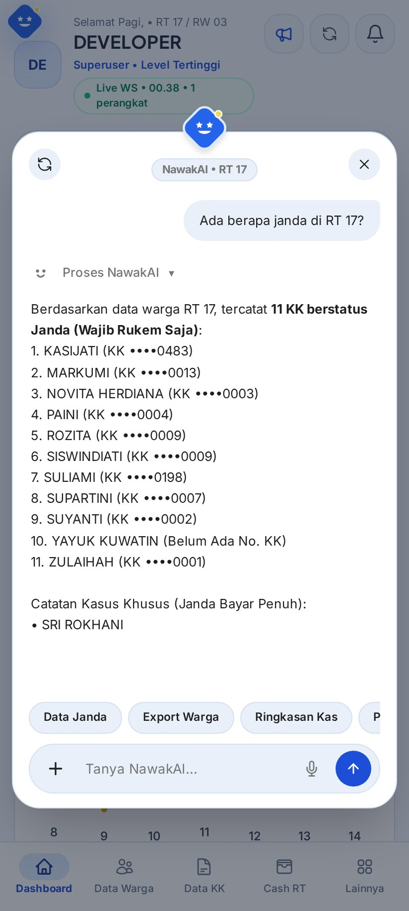
  

  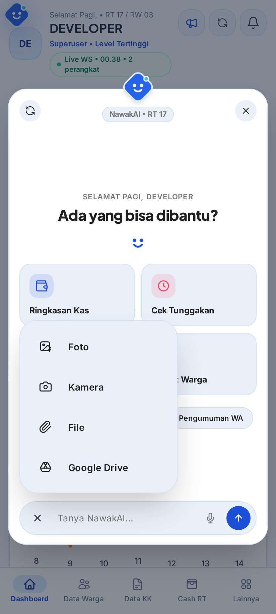
  
  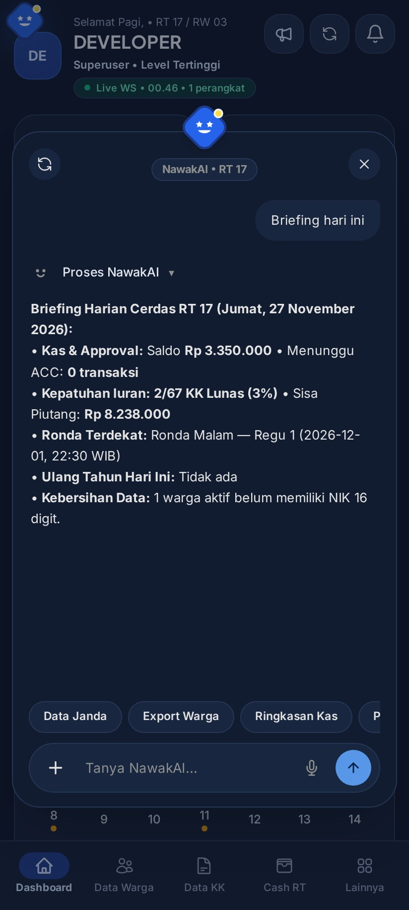
  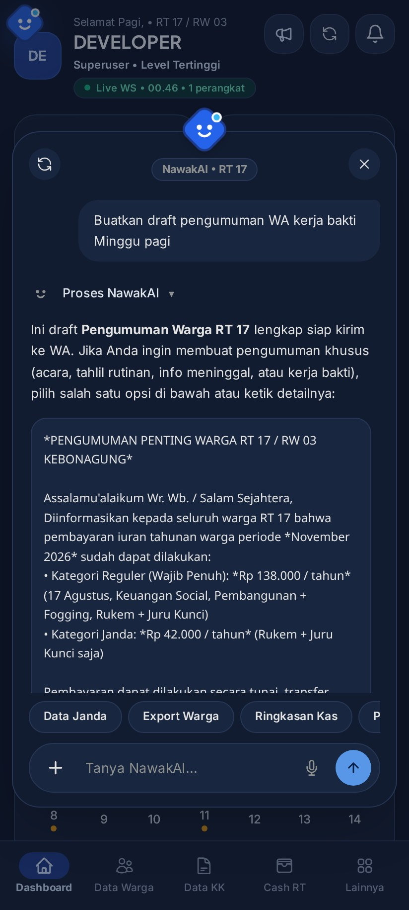

**NawakAI** adalah asisten AI interaktif RT 17 berikon **Wajik Biru** mengambang (*draggable*, posisi tersimpan di memori perangkat) dengan antarmuka **bergaya Gemini** yang beradaptasi penuh antara mode Terang dan Gelap OLED:

### Sub-Menu & Kemampuan Operasional NawakAI

| Sub-Fitur NawakAI | Contoh Perintah / Aksi Nyata | Fungsi & Kegunaan Utama |
| :--- | :--- | :--- |
| **2.1 Beranda Cepat & Tombol Aksi** (`nawak_1.jpg`) | Ketuk kartu *Ringkasan Kas*, *Cek Tunggakan*, *Data Janda*, *Export Warga*, atau chip *Briefing Hari Ini*, *Kartu Ultah*, *Pengumuman WA* | Jalan pintas 1 ketuk untuk memantau data RT terpenting tanpa mengetik dari awal, disertai tombol reset percakapan dan sakelar suara TTS (`🔊/🔇`). |
| **2.2 Analitik Kas & Tunggakan Real-Time** (`nawak_2.jpg`, `nawak_3.jpg`) | `"Ringkasan kas & pemasukan RT bulan ini"`, `"Siapa saja KK yang belum lunas bulan ini?"` | Menghitung otomatis Saldo Awal, Pemasukan/Pengeluaran Approved, Pending Approval, serta mengelompokkan KK status **Lunas**, **Sebagian** (lengkap dengan sisa kurang bayar), dan **Belum Bayar**. |
| **2.3 Direktori Khusus & Jadwal Ronda** (`nawak_4.jpg`, `nawak_5.jpg`) | `"Ada berapa janda di RT 17?"`, `"Jadwal ronda malam regu 1"` | Menyaring daftar KK Janda (*Wajib Rukem* vs *Bayar Penuh*), menampilkan daftar personel regu ronda + personel Kost tambahan lengkap beserta jam wajib jaga. |
| **2.4 Briefing Harian & Audit Data** (`nawak_8.jpg`) | `"Briefing hari ini"`, `"Audit kebersihan NIK & data warga"` | Merangkum kondisi kas, transaksi menunggu ACC, tingkat kepatuhan iuran, jadwal ronda terdekat, daftar ulang tahun hari ini, hingga deteksi data warga tanpa NIK 16 digit. |
| **2.5 Pembuat Draft Pengumuman WA & Surat** (`nawak_9.jpg`) | `"Buatkan draft pengumuman WA kerja bakti Minggu pagi"`, `"Buat surat pengantar domisili"` | Menyusun teks pengumuman WhatsApp terstruktur (*Acara, Kerja Bakti, Tahlil, Berita Duka/Lelayu, Iuran*) maupun draf surat pengantar RT 17 dengan memori revisi multi-turn. |
| **2.6 Pembaca Lampiran `+` & OCR Lokal** (`nawak_6.jpg`) | Lampirkan lewat *Foto, Kamera, File, Google Drive* | Membaca struk belanja/nota, gambar KTP/KK, PDF hingga 10 halaman (*Tesseract.js OCR*), Excel/CSV/ODS, dan Word `.docx` untuk diringkas, dicatat ke kas, atau diimpor anti-duplikat. |
| **2.7 Export Data Warga 4 Format & Filter** (`nawak_7.jpg`) | `"Export warga ke PDF/Excel"`, centang kolom & status | Memilih kolom spesifik (*No, Alamat, No. KK, NIK, Hubungan, Tgl Lahir, No. HP, Status*) dan filter 6 status warga (*Permanen, Kontrak, Kost, Janda, Pindah, Meninggal*) ke **PNG, Excel, Word `.docx`, dan PDF**. |
| **2.8 NLU 5 Lapis, Voice Input & Eksekusi Aksi** | Bahasa gaul/dialek Malangan (`"kas saiki"`, `"sopo drg byr"`), perintah suara | Koreksi typo *Damerau-Levenshtein (≤ 2)*, disambiguasi nama ganda, perekam suara *14-bar waveform* inline, 7 audio ElevenLabs *offline*, serta tombol aksi pelunasan FIFO & *batch approval* khusus pengurus berwenang. |

---

## 3. Tab 2 — Data Warga

  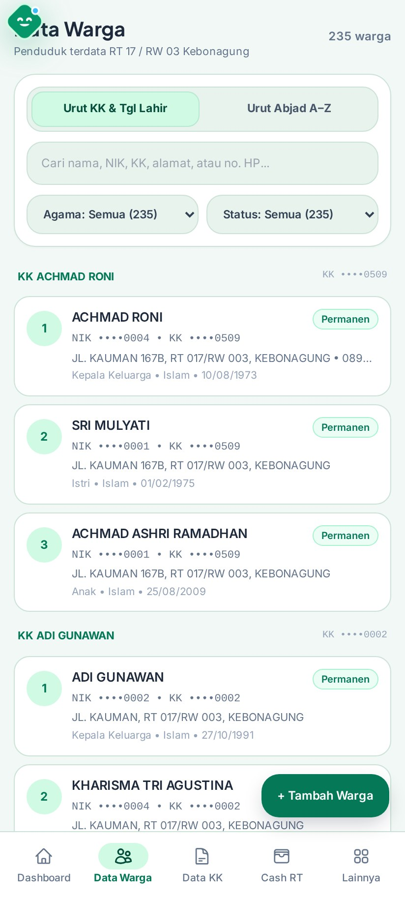
  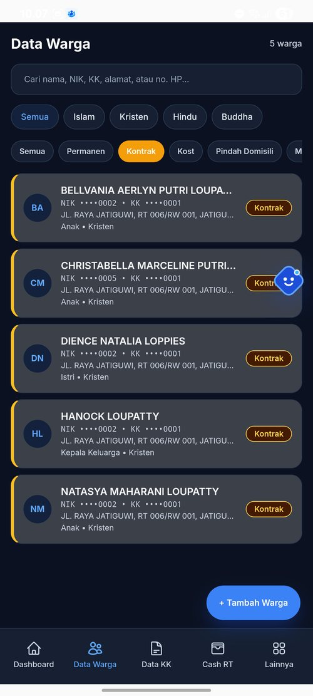
  
  
  
  

*(Ditampilkan dalam palet **Zamrud Asri** — Tema Terang)*

- **3.1 Direktori Terurut Baku & Mode Sortir (`warga_1.jpg`):** Seluruh anggota dalam 1 KK tersusun konsisten mengikuti standar **`Kepala Keluarga → Istri/Suami → Anak → Menantu → Cucu → Orang Tua → Mertua → Famili Lain → Lainnya`** dari tanggal lahir tertua ke termuda (`sortKKMembers` & view database `v_residents_kk_ordered` berkeamanan `security_invoker = true`), dengan opsi beralih ke **Urut Abjad A–Z**.
- **3.2 Pencarian & Filter Multi-Kategori (`warga_2.jpg`, `warga_6.jpg`):** Pencarian nama, NIK, No. KK, alamat, dan nomor HP dipadukan dengan dropdown **Agama** dan **Status** (*Semua, Permanen, Kontrak, Kost, Tidak Aktif di RT 17, Pindah Domisili, Meninggal Dunia*).
- **3.3 Pendaftaran Warga Baru & Tambah Anggota KK (`warga_3.jpg`, `warga_4.jpg`):** Memisahkan alur pembuatan KK baru beserta anggotanya dari penambahan anggota baru pada KK yang sudah tercatat.
- **3.4 Tinjau, Sunting & Sensor NIK Otomatis (`warga_5.jpg`):** Pembaruan alamat otomatis tersinkron ke tabel `households`; tampilan nomor NIK otomatis disensor (`••••0004`) bagi akun yang tidak memegang izin `canUnmaskNik`.

---

## 4. Tab 3 — Data KK & Iuran Tahunan

  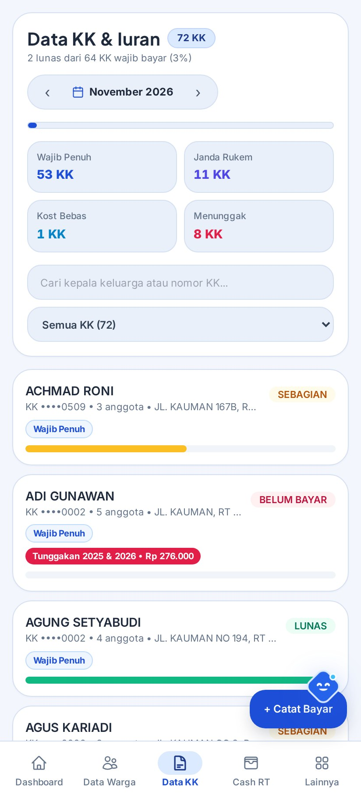
  
  
  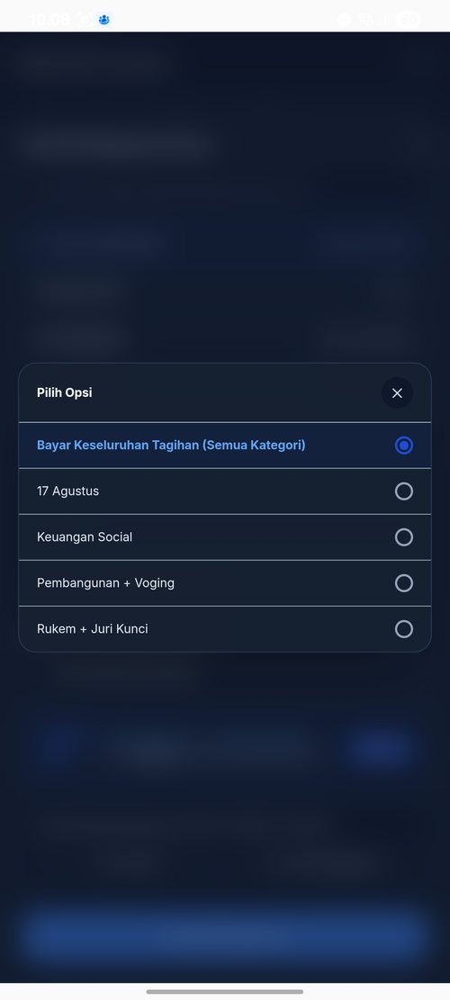

  
  
  

*(Ditampilkan dalam palet **Koral Hangat** — Tema Terang)*

- **4.1 Navigasi Periode Lintas Tahun & 4 Kartu Filter Cepat (`kk_1.jpg`, `kk_2.jpg`, `kk_7.jpg`):**
  - Menampilkan bar progres kepatuhan bayar, tombol pindah periode **`‹` / `›`** yang otomatis berganti tahun (`2026 ↔ 2027`), serta 4 filter cepat (**Wajib Penuh** `Rp 138.000/thn`, **Janda Rukem** `Rp 42.000/thn`, **Kost Bebas**, dan **Menunggak**).
  - Status kartu membedakan **`LUNAS <Tahun>`**, **`SEBAGIAN`**, dan **`BELUM BAYAR`** lengkap dengan lencana akumulasi tunggakan lintas tahun.
- **4.2 Detail KK, Pengingat WA & Tunggakan Manual Beda Tahun (`kk_3.jpg`, `kk_4.jpg`):**
  - Menampilkan susunan anggota keluarga terurut baku, tombol **Edit No. KK**, **Rincian Piutang per Tahun & Kategori**, serta tombol **Ingatkan WhatsApp** santun otomatis.
  - Petugas berizin `canManageManualArrears` dapat membuka **Atur Tunggakan Manual** untuk mencatat atau mengoreksi kewajiban historis tahun sebelumnya (`>= 2020`).
- **4.3 Pembayaran Cicilan FIFO & QRIS Layar Penuh (`kk_5.jpg`, `kk_6.jpg`):**
  - Menggunakan sistem **1 tagihan per tahun per kategori (`010_annual_dues_and_manual_arrears.sql`)**: pembayaran parsial/cicilan di bulan mana pun otomatis mengurangi saldo tahun berjalan atau tahun terlama lebih dulu (*FIFO*), mewajibkan lampiran foto bukti pembayaran, serta menyediakan **QRIS Layar Penuh DANA** yang menaikkan kecerahan layar HP ke 100% secara otomatis.

---

## 5. Tab 4 — Cash RT & Pelaporan Petugas

  
  
  
  

  
  
  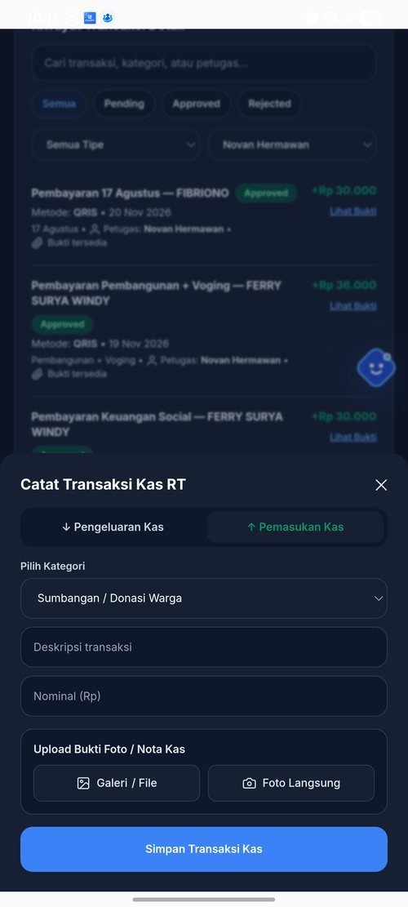

*(Ditampilkan dalam palet **Violet Senja** — Tema Terang)*

- **5.1 Kartu Saldo & Edit Saldo Awal (`cash_1.jpg`):** Memantau **Saldo Kas Saat Ini (Approved)**, **Pemasukan**, **Pengeluaran**, **Saldo Awal** (dengan tombol *Edit* khusus izin `canEditOpening`), dan **Tunggakan**.
- **5.2 Grafik Donat Material You (`cash_2.jpg`):** Menampilkan seluruh kategori pemasukan beserta persentasenya dengan *tooltip* luar agar angka total di tengah tetap bersih terbaca.
- **5.3 Laporan Kas Bulanan & Per Petugas PDF (`cash_3.jpg`):** Menyajikan perbandingan **Month-over-Month (MoM)**, rincian pemasukan/pengeluaran per kategori, rekap tugas **4 Bendahara RT** & pengurus (otomatis memilih cakupan sesuai akun login), serta ekspor **PDF siap cetak**.
- **5.4 Riwayat Transaksi, Catat Kas & Approval (`cash_4.jpg` – `cash_7.jpg`):** Pencarian teks anti-loncat scroll, filter status (**Semua, Pending, Approved, Rejected**), tipe, dan petugas berpaginasi 10 item; pencatatan **10 kategori pemasukan tambahan** atau pengeluaran; serta peninjauan foto nota dengan dialog konfirmasi *ACC / Tolak*.

---

## 6. Tab 5 — Lainnya, Tema Material You & Update In-App

  
  
  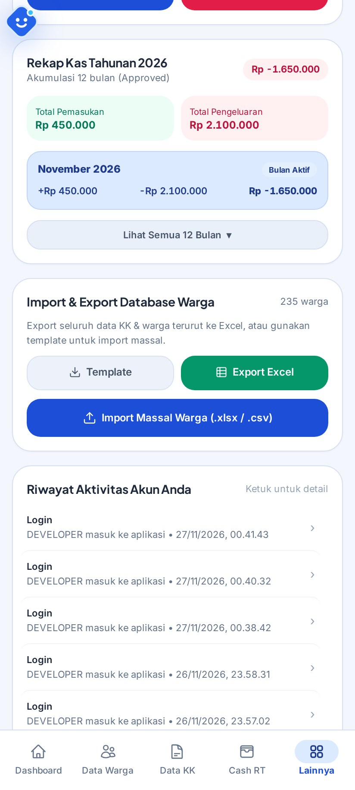
  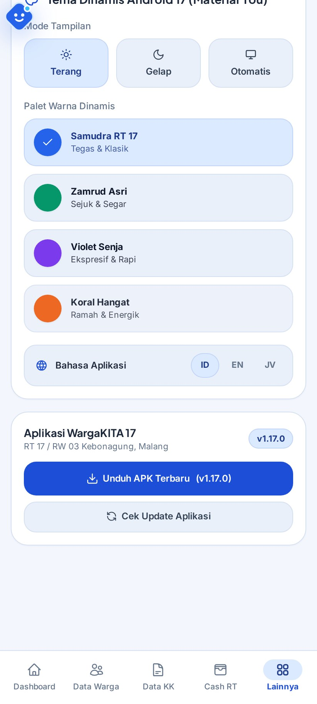

  
  
  
  

- **6.1 Profil Akun & Pengaturan Sandi (`lain_1.jpg`):** Pembaruan nama tampilan, nomor WhatsApp, jabatan, foto avatar, dan penggantian kata sandi mandiri.
- **6.2 Laporan Keuangan 1 Bulan & Rekap Kas Tahunan (`lain_2.jpg`, `lain_3.jpg`):** Preview dan ekspor laporan kas bulanan menjadi **Multi-PNG tajam (16 KK/halaman)** maupun **PDF A4 multi-halaman**, lengkap dengan daftar KK belum lunas, disertai Rekap Kas Tahunan 12 bulan yang menyorot **Bulan Aktif** di posisi teratas.
- **6.3 Import/Export Excel & Log Aktivitas (`lain_3.jpg`):** Unduh template Excel resmi, Export Global data warga terurut baku, Import massal `.xlsx/.csv` anti-duplikat, serta riwayat aktivitas audit berpaginasi.
- **6.4 Tema Material You: 4 Palet Warna & Mode Terang/Gelap (`lain_4.jpg` – `lain_7.jpg`):**
  - Mendukung 3 mode (**Terang**, **Gelap**, **Otomatis Sistem**) serta 4 palet warna (*Samudra RT 17*, *Zamrud Asri*, *Violet Senja*, *Koral Hangat*) + 3 pilihan bahasa (`ID / EN / JV`) dan pengaman dropdown anti-salah pencet saat *scroll*.
- **6.5 Info Aplikasi & Pengunduh APK Dalam Aplikasi (`lain_8.jpg`):**
  - Menekan **Unduh APK Terbaru** atau **Cek Update Aplikasi** mengunduh file `.apk` terbaru **langsung di dalam aplikasi** dengan *progress bar* persentase & ukuran MB hingga pemasangan otomatis (`PackageInstaller`) tanpa mengalihkan pengguna keluar ke browser, serta mendeteksi pembaruan build baru meski masih menggunakan versi `v1.17.0`.

---

## 7. Panel Khusus Developer & 14 Hak Akses Granular

  
  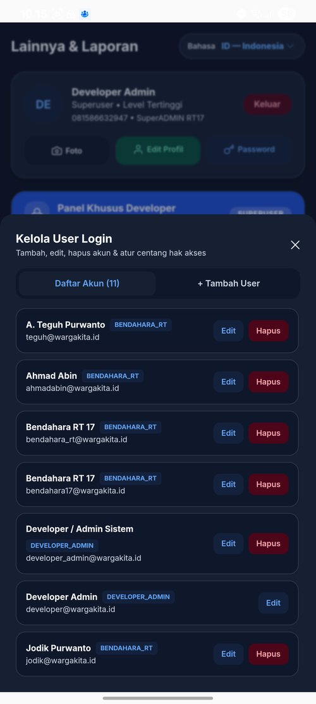
  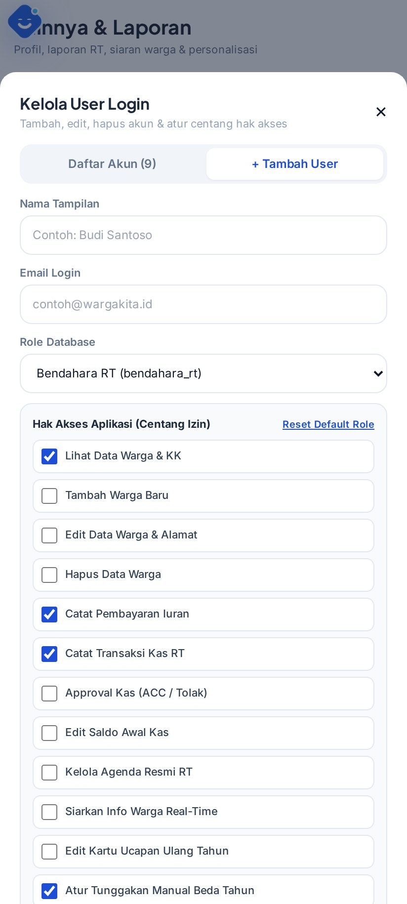
  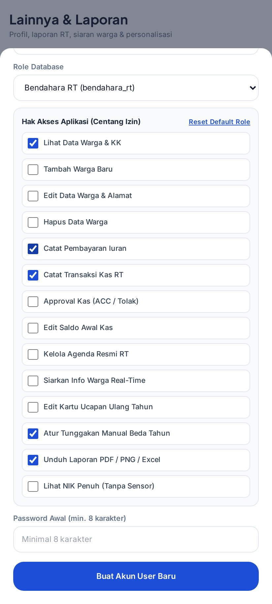
  
  

Khusus akun `developer@wargakita.id`, tersedia **Panel Khusus Developer (`SUPERUSER`)**:

- **7.1 Kelola User Login & 14 Centang Izin Granular (`dev_1.jpg` – `dev_4.jpg`):**
  - Pembuatan, penyuntingan, dan penghapusan akun aman lintas tabel (`developer_list_users`, `developer_create_user`, `developer_update_user`, `developer_delete_user`).
  - Pengaturan **14 centang izin per akun (`custom_permissions`)** yang langsung ditegakkan hingga level PostgreSQL RLS (`public.user_has_permission()`):
    1. Lihat Data Warga & KK (`canViewWarga`)
    2. Tambah Warga Baru (`canAddWarga`)
    3. Edit Data Warga & Alamat (`canEditWarga`)
    4. Hapus Data Warga (`canDeleteWarga`)
    5. Catat Pembayaran Iuran (`canPay`)
    6. Catat Transaksi Kas RT (`canCash`)
    7. Approval Kas / ACC & Tolak (`canApprove`)
    8. Edit Saldo Awal Kas (`canEditOpening`)
    9. Kelola Agenda Resmi RT (`canEditCalendar`)
    10. Siarkan Info Warga Real-Time (`canBroadcastInfo`)
    11. Edit Kartu Ucapan Ulang Tahun (`canEditBirthdayCard`)
    12. Atur Tunggakan Manual Beda Tahun (`canManageManualArrears`)
    13. Unduh Laporan PDF / PNG / Excel (`canExportReports`)
    14. Lihat NIK Penuh Tanpa Sensor (`canUnmaskNik`)
- **7.2 Ubah Password User & Reset Periode (`dev_5.jpg`, `dev_6.jpg`):** Fitur pemulihan sandi darurat akun lain dan reset data transaksi periode berjalan untuk keperluan uji coba sistem.

---

## 8. Matriks Hak Akses & Arsitektur Sistem

| Role Database | Email Contoh | Warga (Lihat/Tambah/Edit/Hapus) | Bayar Iuran & Kas RT | Approval Kas | Tunggakan Manual | Siaran Info & Edit Ultah | Agenda & Saldo Awal | Unduh Laporan | Lihat NIK Penuh | Panel Developer |
| :--- | :--- | :---: | :---: | :---: | :---: | :---: | :---: | :---: | :---: | :---: |
| **Developer Admin** | `developer@wargakita.id` | Penuh | Auto-Approved | Ya | Ya | Ya | Penuh | Ya | Ya | Ya |
| **Pak RT** | `pakrt17@wargakita.id` | Penuh | Auto-Approved | Ya | Ya | Ya | Penuh | Ya | Ya | Tidak |
| **Wakil RT** | `wakilrt17@wargakita.id` | Lihat, Tambah, Hapus | Tidak | Ya | Ya | Ya | Agenda saja | Ya | Tidak | Tidak |
| **Bendahara RT** | `novan@wargakita.id`, `ahmadabin@wargakita.id`, `teguh@wargakita.id`, `jodik@wargakita.id` | Lihat saja | Pending Approval | Tidak | Ya | Tidak | Tidak | Ya | Tidak | Tidak |
| **Sekretaris RT** | `sekretaris17@wargakita.id` | Lihat & Tambah | Tidak | Tidak | Tidak | Tidak | Tidak | Ya | Ya | Tidak |

*(Seluruh izin bawaan di atas dapat dikustomisasi per akun oleh **Developer Admin** melalui **14 centang `custom_permissions`** di menu **Kelola User Login**).*

### Arsitektur Teknis
1. **Autentikasi, RLS & Migrasi Terstruktur (`supabase/005`–`010`):** Login Supabase Auth + proteksi *Row Level Security (RLS)* melalui `user_has_permission()`, view berkeamanan `security_invoker = true` (`v_residents_kk_ordered`), dan konsolidasi tagihan tahunan (`ensure_period_dues`, `upsert_manual_household_due`).
2. **Backend Express & WebSocket (`server.ts` + Supabase Realtime):** Kanal WebSocket `/ws` dan endpoint `/api/notifications/*` + saluran `wk_realtime_dashboard_v1` untuk siaran info lingkungan serta sinyal pembaruan APK ke perangkat aktif.
3. **Updater APK Native Dalam Aplikasi (`MainActivity.kt` & `UpdateCheckReceiver.kt`):** Pengunduhan APK berbasis `HttpURLConnection` + pelaporan progres *real-time* ke WebView + instalasi via `FileProvider` & `REQUEST_INSTALL_PACKAGES`, serta deteksi pembaruan build terbaru berdasarkan `BuildConfig.BUILD_EPOCH_MS`.
4. **Asisten AI Hibrida & Offline Assets:** Supabase Edge Function `nawak-ai` + *silent fallback* NLU 5 lapis lokal + OCR & pembaca dokumen lokal (`Tesseract.js`, `PDF.js`, `Mammoth.js`, `SheetJS`, `jsPDF`) + 7 audio ElevenLabs MP3 *offline*.
5. **Build & Rilis APK Otomatis:** GitHub Actions (`.github/workflows/build-apk.yml`) membangun APK Android (`versionCode = 29`, `versionName = "1.17.0"`), menandatanganinya dengan *keystore* rilis, dan mempublikasikan rilis ke **GitHub Releases**.

---

## Riwayat Perubahan
Lihat rincian lengkap pembaruan fitur, antarmuka, skema SQL, dan perbaikan bug pada [CHANGELOG.md](CHANGELOG.md).
